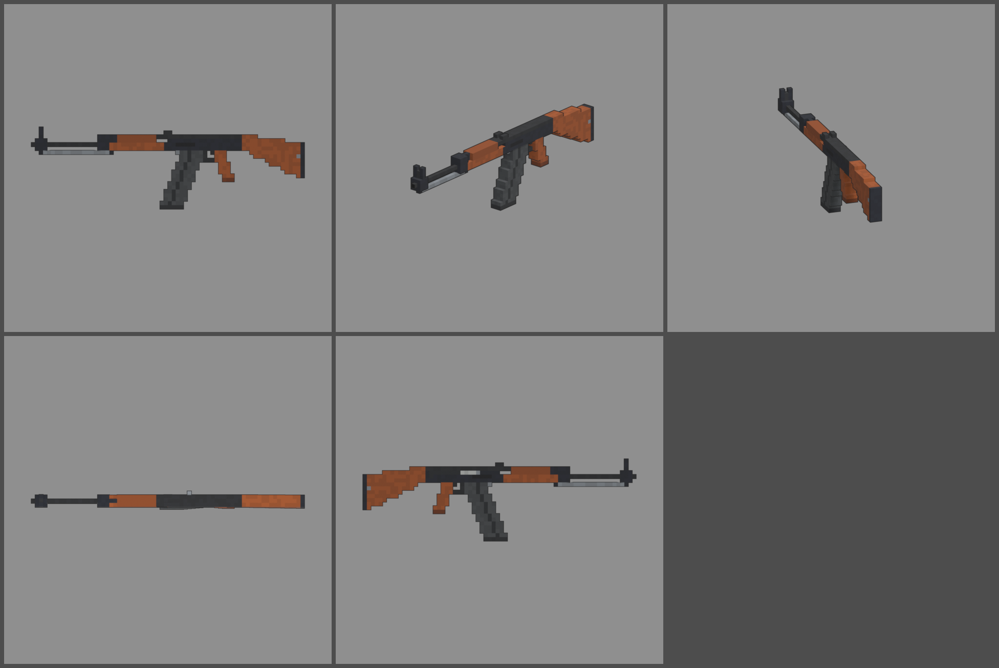

# Fiche d'arme — KA-47 (fusil d'assaut)

Statut : **validée le 2026-10-12**, intégrée au jeu. Arme **nouvelle** (elle n'existait pas
dans l'ancien arsenal). Refonte des armes du 2026-10-12 : armes réelles de
référence, noms proches des vrais, cubes de 1,25 cm, pièces visibles.
Statistiques du jeu (`WeaponDB`, GAME_CONCEPT § 4.9).

*Ligne du haut : profil gauche, trois-quarts, vue du tireur. Ligne du bas :
dessus, profil droit.*

## Identité

| | |
|---|---|
| Référence réelle | AK-47 type 3 (boîtier usiné), 7,62 × 39 mm, chargeur de 30 (1955) |
| Nom affiché (FR / EN) | **KA-47** / **KA-47** (même règle que la KA-74U) |
| Identifiant interne | `ak47` (nouveau) |
| Famille | fusil d'assaut |
| Niveau de base | **23** (entre le STROBOSCOPE, niveau 22, et la BOURRASQUE, niveau 24) |
| Rôle | le fusil qui frappe fort : grosse balle, beaucoup de recul, cadence moyenne |

## Statistiques

| Statistique | Valeur | Pourquoi |
|---|---|---|
| Dégâts par balle | **140** | grosse balle de 7,62 mm (KA-74U : 100 ; MASSE : 150 en semi-auto) |
| Multiplicateur de tête | × 2,5 | famille fusil d'assaut |
| Cadence | **600** coups/min, automatique | cadence réelle |
| Dégâts par seconde (corps) | 1 400 | BOURRASQUE (niveau 24) : 1 375 ; FAMAX F1 (niveau 26) : 1 583 |
| Chargeur / réserve | **30 / 210** | 7 chargeurs de réserve |
| Rechargement | **2,6 s** | chargeur d'acier lourd qu'on bascule en place |
| Précision à la hanche | dispersion **2,8°** (+ 0,4° par tir enchaîné) | famille : 2,6° / 0,35° |
| Précision en visée | 0° | |
| Recul | montée **1,6°**, latéral ± 0,6°, 50 % rendu | le plus fort des fusils d'assaut automatiques |
| Portée (début de la perte de dégâts) | **40 m** | famille : 35 m |
| Pénétration | **3 zombies** | balle lourde (famille : 2) |
| Mobilité | 95 % | famille |
| Mise en joue | 0,24 s, zoom × 0,75 | un peu plus lourd que la famille (0,22 s) |

Repère : au niveau 23, elle fait 448 dégâts par balle. Un zombie de la
manche 23 (2 350 PV) tombe en 6 balles au corps.

Son de tir : `rifle_fire` (son de la famille) en attendant un son propre.

## Pièces (emplacements et points d'attache)

| Famille | Exemples pour cette arme | Point d'attache |
|---|---|---|
| Canon | frein de bouche, silencieux | `att_muzzle` : écrou de bouche |
| Viseur | point rouge ou lunette courte sur rail latéral | `att_optic` : dessus du couvercle |
| Chargeur | chargeur long de 40, tambour de 75 | `att_mag` : puits du chargeur |
| Crosse | crosse repliable en tôle, crosse lourde | `att_stock` : arrière du boîtier |
| Accessoire | lampe, poignée sous le garde-main | `att_rail` : sous le garde-main |
| Culasse | ressort renforcé, porte-culasse allégé | aucun (statistiques seulement) |

## Design

- **70 cubes de long** (880 mm), 1,25 cm par cube.
- **Avant** :
  - au bout du canon, bloc de guidon avec un guidon d'un cube, encadré par
    deux oreilles de protection plus hautes, et un tenon de baïonnette
    dessous ;
  - écrou de bouche ;
  - canon nu, avec la baguette de nettoyage en acier clair dessous et un
    jour d'un cube entre les deux ;
  - bloc d'emprunt de gaz.
- **Garde-mains** en bois verni rouge-brun. La partie haute, sur le tube à
  gaz, est plus courte et un peu plus sombre. Frette d'acier à l'arrière.
- **Hausse à planchette** sur l'arrière du tube à gaz (deux oreilles, cran
  d'un cube).
- **Boîtier usiné** bleu-noir, couvercle noir, évidements usinés au-dessus
  du puits du chargeur. C'est ce qui le distingue de la KA-74U, dont le
  boîtier est embouti avec des rivets.
- **Flanc droit** : fenêtre d'éjection, levier d'armement, levier de
  sélecteur (comme la KA-74U).
- **Chargeur de 30** en acier gris foncé, très courbé, avec des nervures
  embouties sur les flancs.
- **Poignée** en bois inclinée. **Crosse fixe** en bois : le dessus descend
  et le dessous plonge vers une plaque de couche d'acier vissée.
- **Pièces mobiles** : chargeur (`mag`), levier d'armement (`slide`).
- **Budget** : 1 768 triangles.

## Vue FPS

Comme la KA-74U : poing droit qui suit la poignée inclinée (`grip_angle`
≈ −18°), main gauche en **berceau étroit** sous le garde-main de 3,75 cm
(`narrow_support`, pièce `cradle_narrow` des mains). Contrôles :
`test_view_model_fit`, `weapon_aim` (cran et guidon à 0,00 px),
`weapon_view` (chargeur dans l'axe de sa courbe, levier d'armement).

## Intégration (faite le 2026-10-12, arme nouvelle)

- Entrée `ak47` dans `WeaponDB` (statistiques, nom FR / EN, famille fusil
  d'assaut, niveau de base 23, référence réelle « AK-47 type 3 »), dans
  `WeaponModels.SPECS` et dans `docs/WEAPONS.md`.
- Modèle branché (`weapons_fine.py ak47 --export`), rendu du hub
  (`assets/ui/hub/renders/weapons/ak47.png` : arsenal, station, butin).
- Butin et récompenses : elle entre d'elle-même dans le tirage dès la
  manche 21 (niveau de base ≤ manche + 2, `LootRules.weapon_pool`, aussi lu
  par `HubRewards`) ; aucune autre liste d'armes à compléter.
- Son de tir : `rifle_fire` (son de la famille).

## Reste à faire

- Son de tir propre.
- Modèles des pièces visibles (itération commune à la famille).
