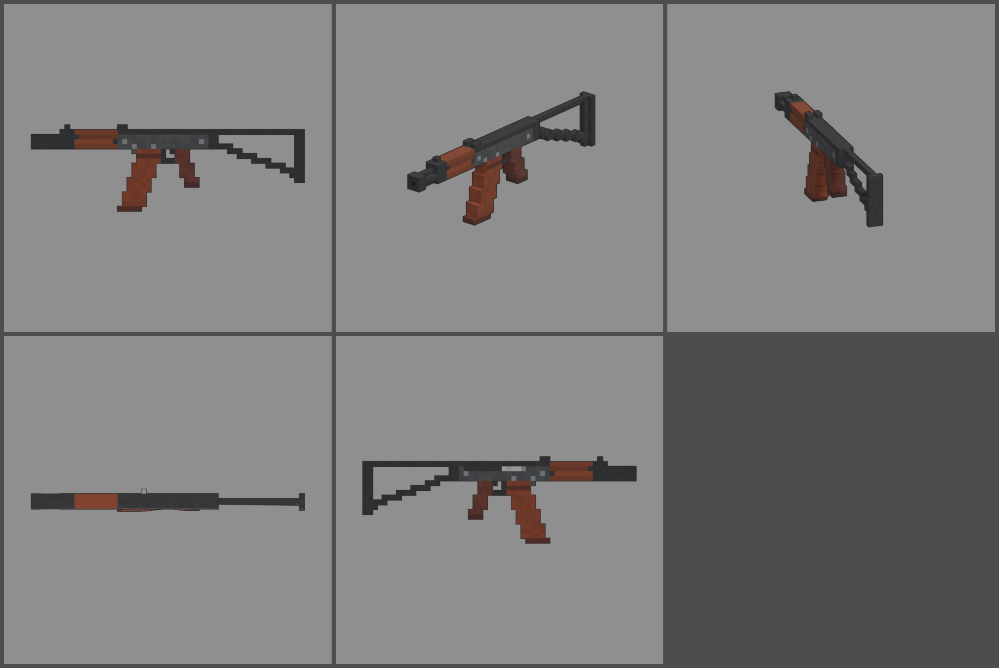

# Fiche d'arme — KA-74U (carabine courte)

Statut : **validée le 2026-10-12**, intégrée au jeu. Refonte des armes du 2026-10-12 : armes
réelles de référence, noms proches des vrais, cubes de 1,25 cm, pièces
visibles. Statistiques du jeu (`WeaponDB`, GAME_CONCEPT § 4.9).

*Ligne du haut : profil gauche, trois-quarts, vue du tireur. Ligne du bas :
dessus, profil droit.*

## Identité

| | |
|---|---|
| Référence réelle | Kalachnikov AKS-74U, 5,45 × 39 mm, chargeur de 30 (1979) |
| Nom affiché (FR / EN) | **KA-74U** / **KA-74U** |
| Identifiant interne | `ak74u` (inchangé) |
| Famille | mitraillette (on garde la famille actuelle du jeu ; en vrai, c'est une carabine courte) |
| Niveau de base | 19 (inchangé) |
| Rôle | arme automatique compacte : chargeur généreux, recul franc, plus de portée qu'une mitraillette |

Nom : on inverse les lettres de la désignation réelle (AK → KA), sans
reprendre la marque « Kalachnikov ».

## Statistiques

| Statistique | Valeur | Ancien BRISE-OS | Pourquoi |
|---|---|---|---|
| Dégâts par balle | **100** | 100 | petite balle rapide de 5,45 mm |
| Multiplicateur de tête | × 2 | × 2 | famille mitraillette |
| Cadence | **700** coups/min, automatique | 780 | cadence réelle (650 à 735) |
| Dégâts par seconde (corps) | 1 167 | 1 300 | un peu moins, compensé par le chargeur |
| Dégâts par chargeur | 3 000 | 2 000 | chargeur de 30 au lieu de 20 |
| Chargeur / réserve | **30 / 180** | 20 / 160 | 30 coups comme le vrai, 6 chargeurs de réserve |
| Rechargement | **2,4 s** | 2,2 s | chargeur qu'on bascule en place, à la manière AK |
| Précision à la hanche | dispersion **2,8°** (+ 0,35° par tir enchaîné) | 2,6° / 0,3° | arme courte et nerveuse |
| Précision en visée | 0° | 0° | |
| Recul | montée **1,3°**, latéral ± 0,55°, 55 % rendu | 1,1° | le canon court relève fort |
| Portée (début de la perte de dégâts) | **28 m** | 25 m | munition de fusil |
| Pénétration | 2 zombies | 2 | |
| Mobilité | 100 % | 100 % | |
| Mise en joue | 0,2 s, zoom × 0,85 | 0,18 s | un peu plus lourde qu'une mitraillette |

Repère : au niveau 19, elle fait 280 dégâts par balle (+ 10 % par niveau).
Un zombie de la manche 19 (1 950 PV) tombe en 7 balles au corps.

## Pièces (emplacements et points d'attache)

| Famille | Exemples pour cette arme | Point d'attache |
|---|---|---|
| Canon | silencieux, compensateur à la place du booster | `att_muzzle` : bouche du booster |
| Viseur | point rouge ou lunette courte sur rail latéral | `att_optic` : dessus du couvercle |
| Chargeur | chargeur long de 45, chargeur tambour | `att_mag` : puits du chargeur |
| Crosse | crosse repliée (mobilité +, précision −), crosse fixe | `att_stock` : charnière à l'arrière du boîtier |
| Accessoire | lampe, poignée sous le garde-main | `att_rail` : sous le garde-main |
| Culasse | ressort renforcé, porte-culasse allégé | aucun (statistiques seulement) |

## Design

- **58 cubes de long** (730 mm, crosse dépliée), 1,25 cm par cube.
- **Booster** au bout du canon : cylindre (section en croix), puis une
  cloche pleine à l'avant. Derrière, le bloc de guidon avec un guidon d'un
  cube.
- **Garde-main** en lamellé-collé rougeâtre, en couches visibles. La partie
  haute, au-dessus du tube à gaz, est plus sombre.
- **Boîtier** embouti gris très foncé et couvercle noir. La hausse est à
  l'avant, sur la charnière du couvercle. Rivets des tourillons et du puits
  du chargeur.
- **Flanc droit** : fenêtre d'éjection (porte-culasse clair au fond), levier
  d'armement qui dépasse, grand levier de sélecteur peint.
- **Chargeur de 30** orangé-brun, qui se courbe vers l'avant, avec une
  nervure de renfort et une semelle sombre.
- **Poignée** en polymère prune, inclinée.
- **Crosse** triangulaire repliable en tôle : charnière, bras haut droit,
  bras bas en escalier, plaque de couche.
- **Pièces mobiles** : chargeur (`mag`, sort dans l'axe de sa courbe),
  levier d'armement (`slide`).
- **Budget** : 1 392 triangles (l'ancien BRISE-OS en avait 588).

## Vue FPS

Les mains (cubes de 2,5 cm, communes à toutes les armes) : poing droit sur
la poignée, qui suit son inclinaison (`grip_angle` ≈ −18°, un cube toutes
les trois rangées) ; main gauche en **berceau étroit** sous le garde-main
(`narrow_support`, pièce `cradle_narrow` des mains : paume de deux cubes,
les doigts et le pouce touchent les flancs du garde-main de 3,75 cm au lieu
de flotter à 2 cm). Contrôles : mains posées sur l'arme
(`test_view_model_fit`), cran et guidon au centre à 0,00 px en visée
(`weapon_aim`), chargeur qui sort dans l'axe de sa courbe et revient
(`weapon_view`), levier d'armement tiré après un chargeur vide.

## Intégration (faite le 2026-10-12)

- Modèle branché (`tools/blender/weapons/weapons_fine.py ak74u --export`,
  ancien modèle retiré de `weapons_voxel.py`), tenue des mains réglée,
  rendu du hub refait.
- Statistiques, nom et référence réelle (« Réf. AKS-74U », fiche DÉTAILS)
  dans `WeaponDB`.

## Reste à faire

- Modèles des pièces visibles (itération commune à la famille).
