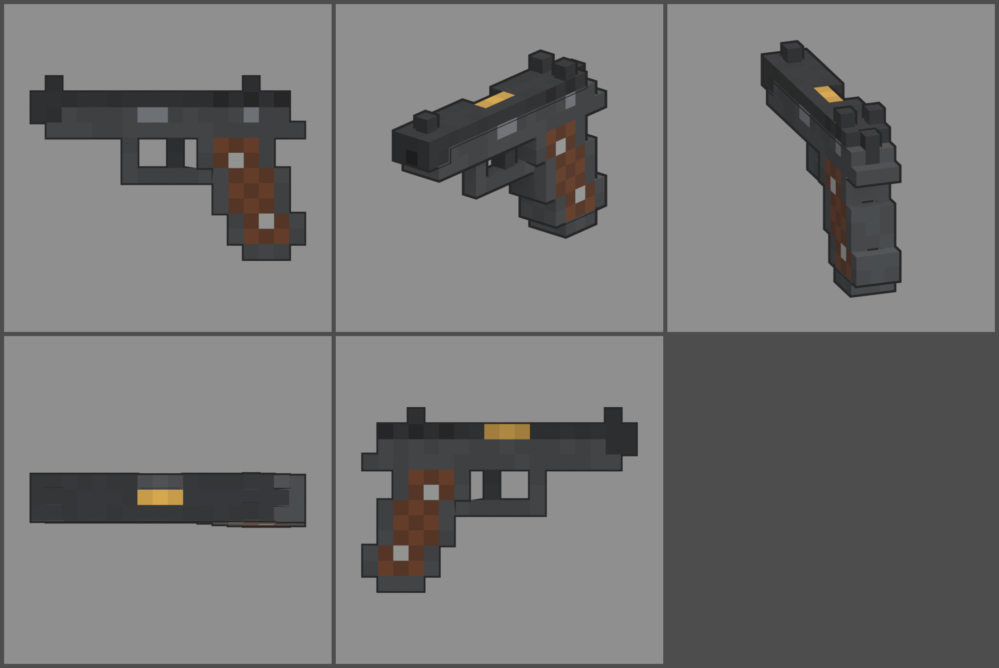

# Fiche d'arme — CS-75 (pistolet)

Statut : **validée le 2026-10-12, à intégrer en jeu (lot 2)**. Refonte des armes du 2026-10-12 : armes
réelles de référence, noms proches des vrais, cubes de 1,25 cm, pièces
visibles. Statistiques du jeu (`WeaponDB`, GAME_CONCEPT § 4.9).

*Ligne du haut : profil gauche, trois-quarts, vue du tireur. Ligne du bas :
dessus, profil droit.*

## Identité

| | |
|---|---|
| Référence réelle | CZ 75 B, 9 × 19 mm, chargeur de 16 (1975) |
| Nom affiché (FR / EN) | **CS-75** / **CS-75** |
| Identifiant interne | `cz75` (inchangé) |
| Famille | pistolet |
| Niveau de base | 8 (inchangé) |
| Rôle | le pistolet sérieux : précis, gros chargeur, recul doux ; l'arme de poing qui reste utile loin dans la partie |

Nom : on change une lettre (Z → S). On ne reprend pas le nom du fabricant.

## Statistiques

| Statistique | Proposition | Ancienne GUÊPE | Pourquoi |
|---|---|---|---|
| Dégâts par balle | **110** | 120 | 9 mm |
| Multiplicateur de tête | × 3 | × 3 | famille pistolet |
| Cadence | **450** coups/min, semi-automatique | 500 | |
| Chargeur / réserve | **16 / 112** | 15 / 105 | 16 coups comme le vrai, 7 chargeurs de réserve |
| Rechargement | **1,7 s** | 1,6 s | |
| Précision à la hanche | dispersion **1,5°** (+ 0,5° par tir enchaîné) | 1,6° / 0,6° | réputé pour sa précision |
| Précision en visée | 0° | 0° | |
| Recul | montée **1,6°**, latéral ± 0,4°, 75 % rendu | 1,8° | lourd, glissière basse dans la main |
| Portée (début de la perte de dégâts) | **25 m** | 25 m | |
| Pénétration | 1 zombie | 1 | |
| Mobilité | 100 % | 100 % | |
| Mise en joue | 0,15 s, zoom × 0,85 | idem | |

Repère : au niveau 8, une balle fait 187 dégâts. Un zombie de la manche 8
(850 PV) tombe en 5 balles au corps ou en 2 à la tête.

## Pièces (emplacements et points d'attache)

| Famille | Exemples pour cette arme | Point d'attache |
|---|---|---|
| Canon | compensateur, silencieux (canon fileté) | `att_muzzle` : bouche |
| Viseur | micro point rouge sur la glissière | `att_optic` : dessus de la glissière |
| Chargeur | chargeur long de 26, semelle allongée | `att_mag` : semelle du chargeur |
| Crosse (plaquettes) | plaquettes caoutchouc, plaquettes alu | `att_grip_l` / `att_grip_r` : flancs de la poignée |
| Accessoire | lampe sous le cache-poussière | `att_rail` : dessous du cache-poussière |
| Culasse | mode automatique (« CZ 75 Auto »), détente de match | aucun (statistiques seulement) |

## Design

- **17 × 11 cubes** (206 × 138 mm), 1,25 cm par cube, 3 cubes de large.
- **Signature : la glissière coulisse DANS la carcasse.** Sur toute la
  longueur, les rails de la carcasse montent sur les flancs jusqu'à
  mi-hauteur de la glissière : la bande gris foncé de la carcasse se lit
  sous la glissière noire, plus basse que celle du M1912.
- **Glissière** noire : stries arrière, fenêtre d'éjection à droite (canon
  en laiton au fond), guidon et hausse à deux oreilles.
- **Carcasse** gris très foncé avec un cache-poussière qui va presque
  jusqu'à la bouche. Arrêtoir de culasse et sûreté peints sur le flanc
  gauche.
- **Arrière** : **chien à anneau** sous la hausse et longue queue de castor.
- **Pontet** raccordé au devant de la poignée, détente.
- **Poignée** inclinée : devant et dos de la carcasse en acier, plaquettes
  de noyer quadrillées avec leurs vis, semelle du chargeur de 16.
- **Pièces mobiles** : glissière (`slide`), chargeur (`mag`, sort dans
  l'axe de la poignée).
- **Budget** : 968 triangles.
