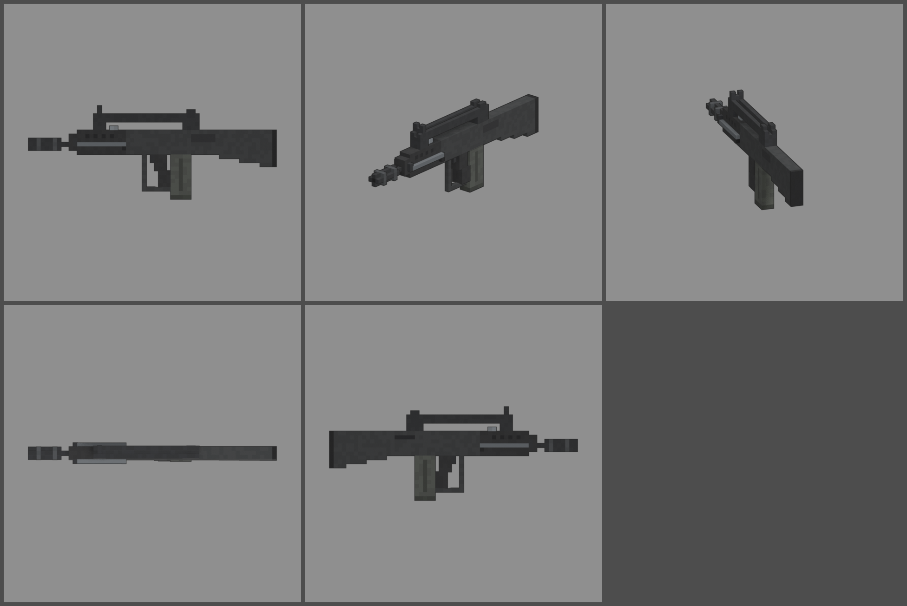

# Fiche d'arme — FAMAX F1 (fusil d'assaut bullpup)

Statut : **validée le 2026-10-12**, intégrée au jeu. Refonte des armes du 2026-10-12 : armes
réelles de référence, noms proches des vrais, cubes de 1,25 cm, pièces
visibles. Statistiques du jeu (`WeaponDB`, GAME_CONCEPT § 4.9).

*Ligne du haut : profil gauche, trois-quarts, vue du tireur. Ligne du bas :
dessus, profil droit.*

## Identité

| | |
|---|---|
| Référence réelle | FAMAS F1 (MAS, Saint-Étienne), 5,56 × 45 mm, chargeur de 25 (1978) |
| Nom affiché (FR / EN) | **FAMAX F1** / **FAMAX F1** |
| Identifiant interne | `famas` (inchangé) |
| Famille | fusil d'assaut |
| Niveau de base | 26 (inchangé) |
| Rôle | le « clairon » : cadence très élevée, recul faible, mais petit chargeur et rechargement lent (bullpup) |

Nom : « FAMAS » est un acronyme. On remplace la dernière lettre et on garde
la version « F1 ».

## Statistiques

| Statistique | Valeur | Ancienne CIGALE | Pourquoi |
|---|---|---|---|
| Dégâts par balle | **100** | 100 | 5,56 mm (KA-47 : 140) |
| Multiplicateur de tête | × 2,5 | × 2,5 | famille |
| Cadence | **950** coups/min, automatique | 900 | cadence réelle (900 à 1 100) |
| Dégâts par seconde (corps) | 1 583 | 1 500 | le plus rapide des fusils autour du niveau 25 |
| Chargeur / réserve | **25 / 175** | 30 / 150 | 25 coups comme le vrai, 7 chargeurs de réserve ; le chargeur se vide en 1,6 s |
| Rechargement | **2,8 s** | 2,6 s | chargeur derrière la poignée (bullpup) |
| Précision à la hanche | dispersion **2,4°** (+ 0,35° par tir enchaîné) | 2,6° / 0,35° | arme compacte et bien équilibrée |
| Précision en visée | 0° | 0° | |
| Recul | montée **1,0°**, latéral ± 0,4°, 60 % rendu | 1,2° | recul faible et régulier |
| Portée (début de la perte de dégâts) | **38 m** | 35 m | |
| Pénétration | 2 zombies | 2 | |
| Mobilité | 95 % | 95 % | |
| Mise en joue | 0,22 s, zoom × 0,75 | idem | |

Repère : au niveau 26, elle fait 350 dégâts par balle. Un zombie de la
manche 26 (2 650 PV) tombe en 8 balles au corps.

Le vrai FAMAS tire aussi par rafales de 3. Le jeu ne permet pas encore de
changer de mode de tir en cours de partie. On pourra le faire plus tard,
par exemple avec une pièce de culasse.

## Pièces (emplacements et points d'attache)

| Famille | Exemples pour cette arme | Point d'attache |
|---|---|---|
| Canon | silencieux, cache-flamme à la place du manchon | `att_muzzle` : bout du manchon |
| Viseur | point rouge ou lunette courte dans la gouttière de la poignée de transport | `att_optic` : pont de la poignée de transport |
| Chargeur | chargeur de 30 | `att_mag` : puits du chargeur |
| Crosse | plaque de couche amortissante, appui-joue | `att_stock` : plaque de couche |
| Accessoire | lampe, poignée sous le garde-main | `att_rail` : sous le garde-main |
| Culasse | ressort renforcé, sélecteur de rafale | aucun (statistiques seulement) |

## Design

- **61 cubes de long** (757 mm), 1,25 cm par cube.
- **Silhouette bullpup** :
  - corps en polymère gris anthracite, garde-main noir avec des fentes
    d'aération ;
  - **manchon lance-grenades** à deux bagues au bout du canon ;
  - **bipied replié** en acier le long des deux flancs, patins en
    caoutchouc ;
  - crosse dont le dessous plonge vers une plaque de couche en caoutchouc.
- **Poignée de transport** en pont au-dessus du corps :
  - **guidon** entre deux oreilles à l'avant, **hausse** à deux oreilles à
    l'arrière, et une **gouttière** au milieu pour viser ;
  - le **levier d'armement** est dessous.
- **Pontet intégral** qui enferme toute la main, détente devant la
  poignée.
- **Chargeur droit de 25** derrière la poignée, en acier gris-vert pour
  ressortir sur le noir.
- **Fenêtre d'éjection** à droite, **appui-joue** à gauche.
- **Pièces mobiles** : chargeur (`mag`, il sort tout droit), levier
  d'armement (`slide`).
- **Budget** : 2 142 triangles.
- **Ligne de mire haute** : la poignée de transport place la ligne de mire
  9 cubes au-dessus de l'axe du canon (11 cm) ; vérifiée à l'intégration
  (« Vue FPS »).

## Vue FPS

Poing droit sur la poignée, qui suit son inclinaison (`grip_angle` ≈ −14°,
un cube toutes les quatre rangées) ; main gauche en berceau sous le
garde-main (le bipied replié le long des flancs élargit l'appui : berceau
normal). **Visée** : la ligne de mire haute est posée sur l'axe de la
caméra (cran et guidon au centre à 0,00 px, `weapon_aim`) ; le corps de
l'arme reste sous la gouttière sans boucher l'écran, et la crosse du
bullpup, juste sous l'œil, est abaissée par la joue de visée
(`test_view_model_fit` : rien trop près de l'œil). Chargeur qui sort tout
droit derrière la poignée et revient (`weapon_view`).

## Intégration (faite le 2026-10-12)

- Modèle branché (`weapons_fine.py famas --export`, ancien modèle retiré de
  `weapons_voxel.py`), tenue des mains vérifiée, rendu du hub refait.
- Statistiques, nom et référence réelle (« Réf. FAMAS F1 ») dans `WeaponDB`.

## Reste à faire

- Tir par rafales de 3 (par exemple une pièce de culasse, plus tard).
- Modèles des pièces visibles (itération commune à la famille).
