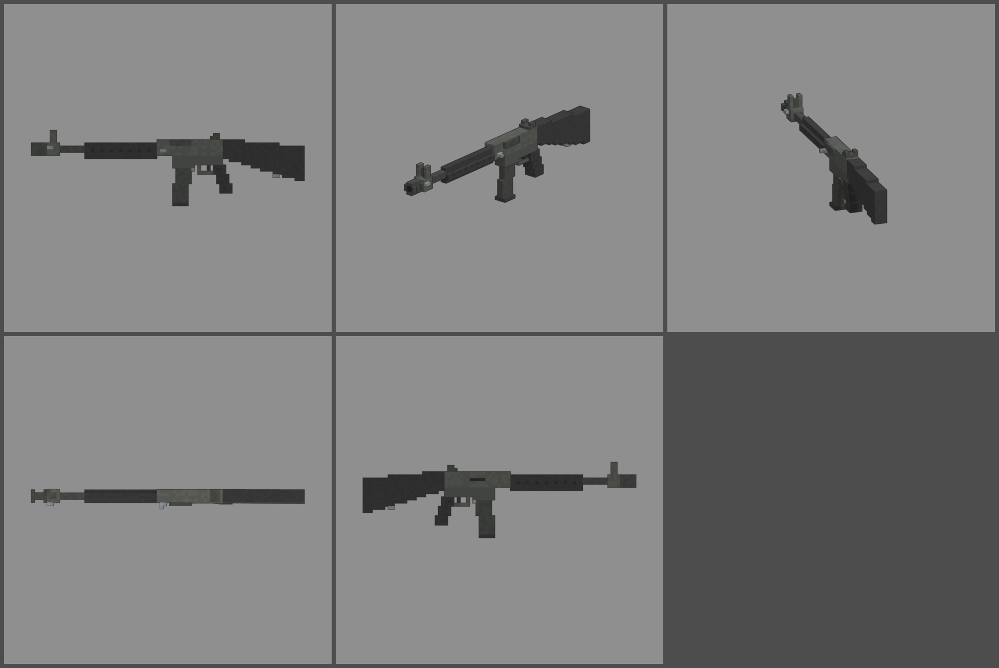

# Fiche d'arme — FAK-50 (fusil de bataille semi-automatique)

Statut : **validée le 2026-10-12, à intégrer en jeu (lot 2)**. Refonte des armes du 2026-10-12 : armes
réelles de référence, noms proches des vrais, cubes de 1,25 cm, pièces
visibles. Statistiques du jeu (`WeaponDB`, GAME_CONCEPT § 4.9).

*Ligne du haut : profil gauche, trois-quarts, vue du tireur. Ligne du bas :
dessus, profil droit.*

## Identité

| | |
|---|---|
| Référence réelle | FN FAL 50.00, 7,62 × 51 mm, chargeur de 20, garnitures en polymère (1953) |
| Nom affiché (FR / EN) | **FAK-50** / **FAK-50** |
| Identifiant interne | `fnfal` (inchangé) |
| Famille | fusil d'assaut (semi-automatique) |
| Niveau de base | 15 (inchangé) |
| Rôle | le grand frère du N14 : un tir par appui, grosse balle qui traverse trois zombies, longue portée |

Nom : on change une lettre de « FAL » et on garde le numéro du modèle
(50.00). On ne reprend pas la marque FN.

## Statistiques

| Statistique | Proposition | Ancienne MASSE | Pourquoi |
|---|---|---|---|
| Dégâts par balle | **160** | 150 | 7,62 × 51 mm (N14 : 120 au niveau 5) |
| Multiplicateur de tête | × 2,5 | × 2,5 | famille |
| Cadence | **420** coups/min, semi-automatique | 400 | |
| Chargeur / réserve | **20 / 120** | 20 / 120 | 20 coups comme le vrai, 6 chargeurs |
| Rechargement | **2,6 s** | 2,6 s | |
| Précision à la hanche | dispersion **2,8°** (+ 0,45° par tir enchaîné) | 2,6° | arme longue |
| Précision en visée | 0° | 0° | |
| Recul | montée **2,0°**, latéral ± 0,55° | 1,2° | gros calibre |
| Portée (début de la perte de dégâts) | **55 m** | 35 m | canon de 533 mm |
| Pénétration | **3 zombies** | 3 | |
| Mobilité | 95 % | 95 % | |
| Mise en joue | **0,26 s**, zoom × 0,75 | 0,22 s | 1,09 m de long |

Repère : au niveau 15, une balle fait 384 dégâts. Un zombie de la manche
15 (1 550 PV) tombe en 5 balles au corps ou en 2 à la tête.

## Pièces (emplacements et points d'attache)

| Famille | Exemples pour cette arme | Point d'attache |
|---|---|---|
| Canon | frein de bouche, silencieux | `att_muzzle` : cache-flamme |
| Viseur | lunette courte ou longue sur le couvercle | `att_optic` : dessus du boîtier |
| Chargeur | chargeur de 30 | `att_mag` : puits du chargeur |
| Crosse | crosse repliable (« para »), appui-joue | `att_stock` : plaque de couche |
| Accessoire | bipied, poignée sous le garde-main | `att_rail` : sous le garde-main |
| Culasse | tir automatique, ressort renforcé | aucun (statistiques seulement) |

## Design

- **87 cubes de long** (1 090 mm), 1,25 cm par cube. **Largeurs paires** :
  canon de 2 × 2 cubes, boîtier, garde-main et crosse de 4.
- **Long cache-flamme à fentes** au bout du canon.
- **Bloc de guidon et de gaz** : guidon de 2 cubes entre deux oreilles,
  régulateur de gaz sur le flanc gauche.
- **Garde-main** en polymère noir, ajouré de fentes d'aération.
- **Boîtier** parkérisé gris (supérieur et inférieur) :
  - fenêtre d'éjection à droite ;
  - **poignée de transport repliée** à plat sur le flanc gauche ;
  - **levier d'armement** à gauche, à l'avant (pièce mobile `slide`) ;
  - **hausse à œilleton** sur le couvercle (deux oreilles, cran de 2).
- **Chargeur droit de 20** parkérisé sombre, à peine courbé, semelle noire,
  levier de déverrouillage derrière.
- **Pontet**, détente, **poignée pistolet** noire nervurée.
- **Crosse fixe** noire : poignet fin derrière le boîtier, dessous qui
  plonge vers la plaque de couche, anneau de grenadière collé dessous.
- **Pièces mobiles** : levier d'armement (`slide`), chargeur (`mag`).
- **Budget** : 2 556 triangles.
