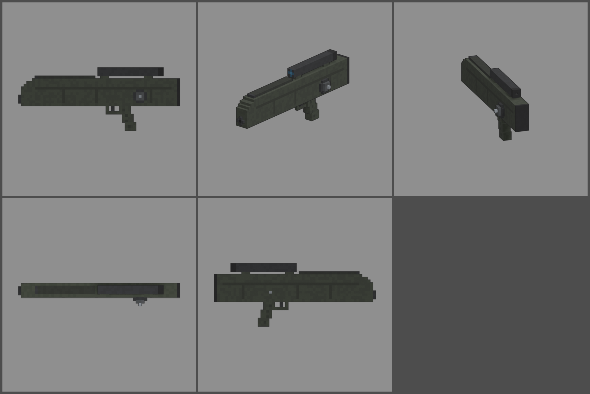

# Fiche d'arme — GX-11 (fusil à munitions sans douille)

Statut : **validée le 2026-10-12, à intégrer en jeu (lot 2)**. Refonte des armes du 2026-10-12 : armes
réelles de référence, noms proches des vrais, cubes de 1,25 cm, pièces
visibles. Statistiques du jeu (`WeaponDB`, GAME_CONCEPT § 4.9).

*Ligne du haut : profil gauche, trois-quarts, vue du tireur. Ligne du bas :
dessus, profil droit.*

## Identité

| | |
|---|---|
| Référence réelle | HK G11 K2, 4,73 × 33 mm sans douille, chargeur de 50 couché au-dessus du canon, rafale de 3 ultra-rapide (1990) |
| Nom affiché (FR / EN) | **GX-11** / **GX-11** |
| Identifiant interne | `g11` (inchangé) |
| Famille | fusil d'assaut |
| Niveau de base | 22 (inchangé) |
| Rôle | le fusil du futur : rafales de 3 si rapides que le recul n'arrive qu'après la troisième balle, lunette intégrée, gros chargeur |

Nom : on insère un X dans la désignation, sans le nom du fabricant.

## Statistiques

| Statistique | Proposition | Ancien STROBOSCOPE | Pourquoi |
|---|---|---|---|
| Dégâts par balle | **120** | 110 | petite balle sans douille |
| Multiplicateur de tête | × 2,5 | × 2,5 | famille |
| Mode de tir | **rafale de 3** | rafale de 3 | « hyper-rafale » du vrai G11 |
| Cadence dans la rafale | **2 000** coups/min, puis 0,25 s de pause | 1 800 | une rafale = 360 dégâts en 0,34 s |
| Dégâts par seconde (corps) | ≈ 1 060 en rafales enchaînées | ≈ 950 | |
| Chargeur / réserve | **50 / 200** | 48 / 192 | 50 coups comme le vrai K2 |
| Rechargement | **3,0 s** | 2,6 s | chargeur couché, trappe sur le dessus |
| Précision à la hanche | dispersion **2,2°** (+ 0,2° par tir enchaîné) | 2,6° | |
| Précision en visée | 0° | 0° | |
| Recul | montée **0,6°**, latéral ± 0,3° | 1,2° | le recul arrive après la rafale |
| Portée (début de la perte de dégâts) | **50 m** | 35 m | |
| Pénétration | 2 zombies | 2 | |
| Mobilité | 95 % | 95 % | |
| Mise en joue | **0,26 s**, lunette courte (zoom × 0,6) | 0,22 s, lunette courte | lunette intégrée |

Repère : au niveau 22, une balle fait 372 dégâts, une rafale 1 116. Un
zombie de la manche 22 (2 250 PV) tombe en 2 rafales et une balle au corps,
ou en une seule rafale si les trois balles touchent la tête.

## Pièces (emplacements et points d'attache)

| Famille | Exemples pour cette arme | Point d'attache |
|---|---|---|
| Canon | silencieux, cache-flamme | `att_muzzle` : bouche, en bas de l'avant |
| Viseur | lunette plus forte, point rouge sur la poignée | `att_optic` : dessus de la poignée-lunette |
| Chargeur | double chargeur (deux de 50 accolés) | `att_mag` : trappe du dessus |
| Crosse | plaque de couche amortissante | `att_stock` : plaque de couche |
| Accessoire | bipied, lampe | `att_rail` : sous l'avant du boîtier |
| Culasse | tir automatique, rafale de 2 | aucun (statistiques seulement) |

## Design

- **59 cubes de long** (750 mm), 1,25 cm par cube, 5 cubes de large.
- **Grand boîtier fermé** en polymère vert-noir, avec ses joints de coque et
  sa nervure longitudinale, avant chanfreiné en escalier, petit canon qui
  sort en bas de l'avant.
- **Trappe du chargeur couché** sur le dessus avant (pièce mobile `mag`) :
  le chargeur de 50 se glisse au-dessus du canon.
- **Poignée de transport à lunette intégrée** : deux montants, tube noir,
  objectif bleu à l'avant, œilleton en caoutchouc à l'arrière. La visée
  passe dans l'axe de la lunette.
- **Grosse molette d'armement** ronde sur le flanc gauche, avec sa poignée
  (pièce mobile `slide`).
- **Poignée pistolet** sous le milieu, pontet, sélecteur à droite.
- **Plaque de couche** en caoutchouc.
- **Pièces mobiles** : trappe du chargeur (`mag`), molette (`slide`).
- **Budget** : 2 550 triangles.
