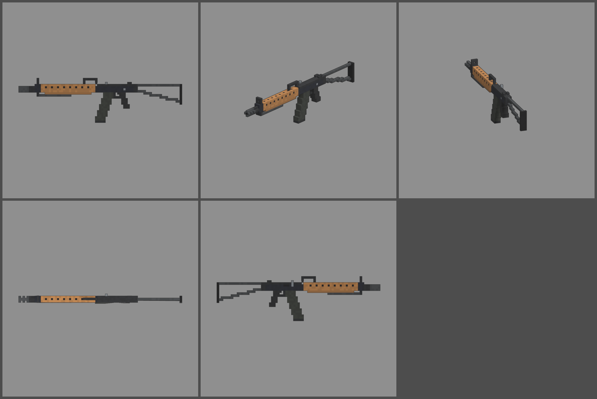

# Fiche d'arme — GALIX ARM (fusil d'assaut à bipied)

Statut : **proposition, à valider**. Refonte des armes du 2026-10-12 : armes
réelles de référence, noms proches des vrais, cubes de 1,25 cm, pièces
visibles. Statistiques du jeu (`WeaponDB`, GAME_CONCEPT § 4.9).

*Ligne du haut : profil gauche, trois-quarts, vue du tireur. Ligne du bas :
dessus, profil droit.*

## Identité

| | |
|---|---|
| Référence réelle | IMI Galil ARM, 5,56 × 45 mm, chargeur courbe de 35, bipied, crosse repliable (1972) |
| Nom affiché (FR / EN) | **GALIX ARM** / **GALIX ARM** |
| Identifiant interne | `galil` (inchangé) |
| Famille | fusil d'assaut |
| Niveau de base | 24 (inchangé) |
| Rôle | le fusil lourd et endurant : gros chargeur de 35, tir soutenu précis, mais lourd à manier |

Nom : on change la dernière lettre et on garde la version « ARM » (fusil
mitrailleur à bipied), sans la marque IMI.

## Statistiques

| Statistique | Proposition | Ancienne BOURRASQUE | Pourquoi |
|---|---|---|---|
| Dégâts par balle | **115** | 110 | 5,56 mm, canon long |
| Multiplicateur de tête | × 2,5 | × 2,5 | famille |
| Cadence | **700** coups/min, automatique | 750 | cadence réelle (650 à 750) |
| Dégâts par seconde (corps) | 1 342 | 1 375 | KA-47 (niveau 23) : 1 400 |
| Chargeur / réserve | **35 / 210** | 35 / 315 | 35 coups comme le vrai, 6 chargeurs |
| Rechargement | **2,8 s** | 2,8 s | |
| Précision à la hanche | dispersion **2,6°** (+ 0,3° par tir enchaîné) | 2,6° | lourd : la dispersion grimpe peu |
| Précision en visée | 0° | 0° | |
| Recul | montée **1,1°**, latéral ± 0,45° | 1,2° | 4,3 kg : très stable |
| Portée (début de la perte de dégâts) | **45 m** | 35 m | |
| Pénétration | 2 zombies | 2 | |
| Mobilité | **90 %** | 95 % | le plus lourd des fusils d'assaut |
| Mise en joue | **0,26 s**, zoom × 0,75 | 0,22 s | |

Repère : au niveau 24, une balle fait 380 dégâts. Un zombie de la manche
24 (2 450 PV) tombe en 7 balles au corps ; un chargeur en tue 5.

## Pièces (emplacements et points d'attache)

| Famille | Exemples pour cette arme | Point d'attache |
|---|---|---|
| Canon | frein de bouche, silencieux | `att_muzzle` : cache-flamme |
| Viseur | point rouge ou lunette courte sur rail latéral | `att_optic` : dessus du boîtier |
| Chargeur | chargeur de 50, tambour | `att_mag` : puits du chargeur |
| Crosse | crosse repliée (mobilité +, précision −), crosse fixe | `att_stock` : charnière de la crosse |
| Accessoire | bipied déplié (recul −, mobilité −), lampe | `att_rail` : sous le garde-main |
| Culasse | ressort renforcé, culasse allégée | aucun (statistiques seulement) |

## Design

- **76 cubes de long** (979 mm, crosse dépliée), 1,25 cm par cube, 3 cubes
  de large.
- **Proportions du Galil** (version 2) : le **long garde-main en bois**
  va du boîtier jusqu'au bloc de gaz ; seul un canon court et le
  cache-flamme dépassent devant le guidon. La première version, avec un
  long canon nu entre garde-main et guidon, ressemblait trop au FAL.
- **Avant** : cache-flamme à fentes, canon court en section en croix,
  bloc de gaz et **guidon à tunnel**.
- **Garde-main** en bois clair, plus large en bas, fentes d'aération sur
  le dessus et les flancs.
- **Bipied replié** sous le garde-main : deux jambes, pivot sous le bloc
  de gaz.
- **Poignée de transport** juste devant le boîtier, sur le tube à gaz.
- **Boîtier** bronzé de Kalachnikov, couvercle noir, hausse à l'arrière.
  **Levier d'armement relevé** à droite, la signature du Galil (pièce
  mobile `slide`). Fenêtre d'éjection à droite, sélecteur à gauche.
- **Chargeur courbe de 35** parkérisé sombre, semelle noire.
- **Pontet**, détente, **poignée** noire inclinée.
- **Crosse tubulaire** dépliée : charnière, tube haut, tube bas qui
  descend, plaque de couche en caoutchouc.
- **Pièces mobiles** : levier d'armement (`slide`), chargeur (`mag`).
- **Budget** : 1 962 triangles.
