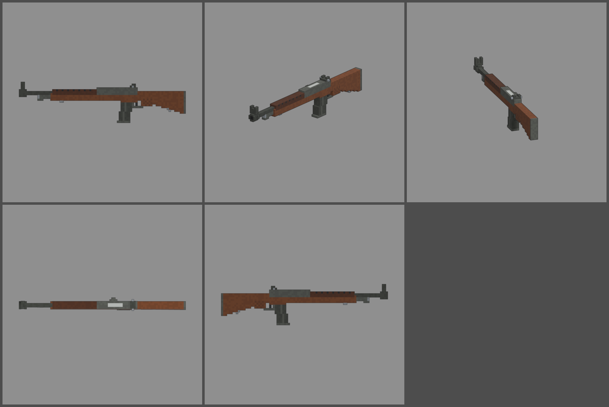

# Fiche d'arme — N14 (fusil semi-automatique)

Statut : **proposition, à valider**. Refonte des armes du 2026-10-12 : armes
réelles de référence, noms proches des vrais, cubes de 1,25 cm, pièces
visibles. Statistiques du jeu (`WeaponDB`, GAME_CONCEPT § 4.9).

*Ligne du haut : profil gauche, trois-quarts, vue du tireur. Ligne du bas :
dessus, profil droit.*

## Identité

| | |
|---|---|
| Référence réelle | M14, 7,62 × 51 mm, chargeur de 20, canon de 559 mm (1959) |
| Nom affiché (FR / EN) | **N14** / **N14** |
| Identifiant interne | `m14` (inchangé) |
| Famille | fusil d'assaut (semi-automatique) |
| Niveau de base | 5 (inchangé) |
| Rôle | le premier fusil qui frappe fort : un tir par appui, grosse balle, longue portée |

Nom : on décale la lettre (M → N). « M15 » et « Mk 14 » sont d'autres armes
réelles, on les évite.

## Statistiques

| Statistique | Proposition | Ancien MÉTRONOME | Pourquoi |
|---|---|---|---|
| Dégâts par balle | **120** | 105 | 7,62 × 51 mm |
| Multiplicateur de tête | × 2,5 | × 2,5 | famille |
| Cadence | **360** coups/min, semi-automatique | 380 | un tir par appui |
| Chargeur / réserve | **20 / 100** | 8 / 96 | 20 coups comme le vrai, 5 chargeurs de réserve |
| Rechargement | **2,4 s** | 1,9 s | chargeur basculé en place, gros calibre |
| Précision à la hanche | dispersion **3,0°** (+ 0,5° par tir enchaîné) | 2,6° | arme longue, peu maniable à la hanche |
| Précision en visée | 0° | 0° | |
| Recul | montée **2,2°**, latéral ± 0,6° | 1,2° | gros calibre, arme légère pour sa munition |
| Portée (début de la perte de dégâts) | **50 m** | 35 m | canon long |
| Pénétration | **3 zombies** | 2 | balle lourde |
| Mobilité | 95 % | 95 % | |
| Mise en joue | **0,28 s**, zoom × 0,75 | 0,22 s | 1,1 m de long |

Repère : au niveau 5, une balle fait 168 dégâts. Un zombie de la manche 5
(550 PV) tombe en 4 balles au corps ou en 2 à la tête. La pénétration de 3
récompense les tirs dans une file de zombies.

## Pièces (emplacements et points d'attache)

| Famille | Exemples pour cette arme | Point d'attache |
|---|---|---|
| Canon | frein de bouche, silencieux | `att_muzzle` : cache-flamme |
| Viseur | lunette courte ou longue sur un montage latéral | `att_optic` : au-dessus du boîtier |
| Chargeur | chargeur long de 30 | `att_mag` : puits du chargeur |
| Crosse | appui-joue, plaque de couche amortissante | `att_stock` : plaque de couche |
| Accessoire | bipied, poignée sous le fût | `att_rail` : sous le fût |
| Culasse | mode rafale (« M14E2 »), ressort renforcé | aucun (statistiques seulement) |

## Design

- **90 cubes de long** (1 118 mm), 1,25 cm par cube. **Largeurs paires** :
  canon de 2 × 2 cubes, crosse et boîtier de 4.
- **Cache-flamme** à branches (tube aux coins abattus, fentes sur les
  côtés). Il porte le **guidon** de 2 cubes sur un socle, entre deux
  oreilles plus hautes.
- **Sous le canon** : cylindre de gaz avec son bouchon d'acier, tenon de
  baïonnette.
- **Crosse en noyer** d'un seul tenant :
  - fût sous le canon, flancs qui l'encadrent ;
  - **garde-main supérieur** plus sombre avec ses fentes d'aération ;
  - poignet creusé derrière le boîtier, demi-poignée pistolet quadrillée ;
  - crosse qui s'élargit jusqu'à la **plaque de couche** d'acier ;
  - deux **anneaux de grenadière**, collés au bois.
- **Boîtier** parkérisé gris-vert, ouvert sur le dessus (porte-culasse
  clair visible).
- **Levier de manœuvre** en bosse sur le flanc droit : c'est la pièce
  mobile `slide`.
- **Hausse à œilleton** avec ses deux molettes, à l'arrière du boîtier.
- **Chargeur droit de 20** parkérisé, à peine courbé, nervuré, avec une
  semelle.
- **Pièces mobiles** : levier de manœuvre (`slide`), chargeur (`mag`).
- **Budget** : 2 704 triangles.
- **Contrôle ajouté** : le script refuse désormais un modèle dont une pièce
  a des cubes détachés (« blocs qui flottent »).
