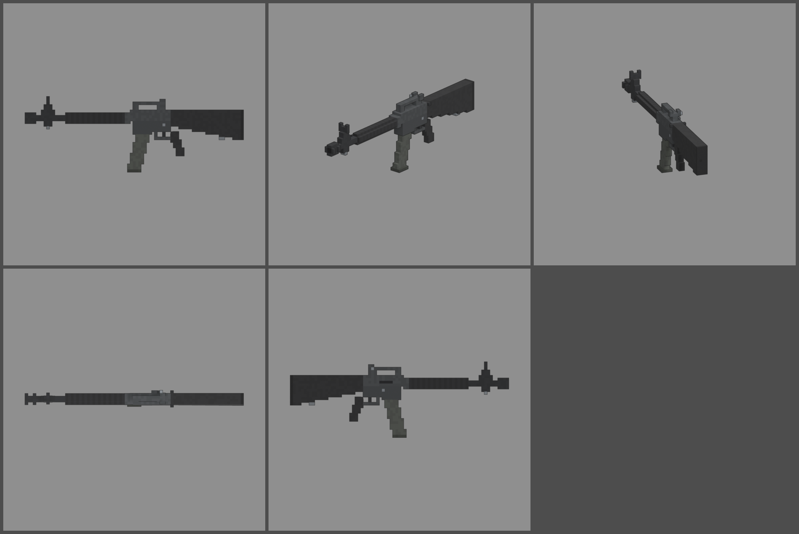

# Fiche d'arme — N16A2 (fusil d'assaut à rafales)

Statut : **proposition, à valider**. Refonte des armes du 2026-10-12 : armes
réelles de référence, noms proches des vrais, cubes de 1,25 cm, pièces
visibles. Statistiques du jeu (`WeaponDB`, GAME_CONCEPT § 4.9).

*Ligne du haut : profil gauche, trois-quarts, vue du tireur. Ligne du bas :
dessus, profil droit.*

## Identité

| | |
|---|---|
| Référence réelle | M16A2, 5,56 × 45 mm, rafales de 3, chargeur courbe de 30 (1983) |
| Nom affiché (FR / EN) | **N16A2** / **N16A2** |
| Identifiant interne | `m16` (inchangé) |
| Famille | fusil d'assaut |
| Niveau de base | 12 (inchangé) |
| Rôle | le fusil de précision à rafales : trois balles par appui, très précis et longue portée, mais moins de dégâts par seconde qu'une arme automatique |

Nom : on décale la lettre (M → N), comme pour le N14. On garde « A2 »,
la version à rafales.

## Statistiques

| Statistique | Proposition | Ancienne TRIPLETTE | Pourquoi |
|---|---|---|---|
| Dégâts par balle | **130** | 110 | 5,56 mm, canon long de 508 mm |
| Multiplicateur de tête | × 2,5 | × 2,5 | famille |
| Mode de tir | **rafale de 3** | rafale de 3 | comme le vrai A2 |
| Cadence dans la rafale | **900** coups/min, puis 0,2 s de pause | 900, pause 0,22 s | une rafale = 390 dégâts en 0,4 s |
| Dégâts par seconde (corps) | ≈ 975 en rafales enchaînées | ≈ 790 | l'arme pardonne moins, mais chaque rafale tue vite |
| Chargeur / réserve | **30 / 180** | 30 / 120 | 10 rafales par chargeur, 6 chargeurs de réserve |
| Rechargement | **2,4 s** | 2,2 s | |
| Précision à la hanche | dispersion **2,2°** (+ 0,3° par tir enchaîné) | 2,0° | |
| Précision en visée | 0° | 0° | |
| Recul | montée **1,0°**, latéral ± 0,35°, 60 % rendu | 1,2° | 5,56 mm, crosse dans l'axe : très tenu |
| Portée (début de la perte de dégâts) | **50 m** | 40 m | canon long |
| Pénétration | 2 zombies | 2 | |
| Mobilité | 95 % | 95 % | |
| Mise en joue | **0,24 s**, zoom × 0,75 | 0,22 s | 1 m de long |

Repère : au niveau 12, une balle fait 273 dégâts, une rafale 819. Un
zombie de la manche 12 (1 250 PV) tombe en 2 rafales au corps, ou en une
seule si deux balles touchent la tête.

## Pièces (emplacements et points d'attache)

| Famille | Exemples pour cette arme | Point d'attache |
|---|---|---|
| Canon | frein de bouche, silencieux à la place de la cage à oiseau | `att_muzzle` : cache-flamme |
| Viseur | lunette courte ou point rouge monté sur la poignée de transport | `att_optic` : pont de la poignée de transport |
| Chargeur | chargeur de 40, tambour de 100 | `att_mag` : puits du chargeur |
| Crosse | crosse télescopique (mobilité +), appui-joue | `att_stock` : plaque de couche |
| Accessoire | lance-grenades sous le canon (purement visuel), poignée avant, lampe | `att_rail` : sous les garde-mains |
| Culasse | tir automatique (« A1 »), ressort renforcé | aucun (statistiques seulement) |

## Design

- **81 cubes de long** (1 006 mm), 1,25 cm par cube. **Largeurs paires** :
  canon de 2 × 2 cubes, garde-mains, boîtier et crosse de 4 cubes.
- **Avant** :
  - **cache-flamme « cage à oiseau »** (tube aux coins abattus, fentes sur
    les côtés) ;
  - **guidon en tour triangulaire**, la signature de la famille : base
    large sur le canon, sommet étroit, guidon de 2 cubes entre deux
    oreilles ; tenon de baïonnette et anneau de grenadière dessous ;
  - canon nu jusqu'aux garde-mains.
- **Garde-mains ronds nervurés** en polymère noir (anneaux clairs et
  sombres), **bague « delta »** contre le boîtier.
- **Boîtier** supérieur et inférieur en alu anodisé gris très foncé.
  - **Flanc droit** : fenêtre d'éjection, assistance de fermeture,
    déflecteur de douilles, bouton du chargeur.
  - **Flanc gauche** : sélecteur.
- **Poignée de transport** : montants, pont, **hausse** à l'arrière (deux
  oreilles, cran de 2 cubes) et sa molette. Ligne de mire à 8,75 cm
  au-dessus de l'axe du canon (choix validé, un peu plus haute que le vrai).
- **Levier d'armement en T** à l'arrière du boîtier (pièce mobile `slide`).
- **Chargeur courbe de 30** gris (2 × 5 cubes), semelle.
- **Pontet**, détente, **poignée à ergot** entre deux doigts.
- **Crosse fixe dans l'axe du canon** : dessus droit au ras du boîtier,
  dessous qui descend, plaque de couche avec sa trappe, anneau de
  grenadière collé dessous.
- **Pièces mobiles** : levier d'armement (`slide`), chargeur (`mag`).
- **Budget** : 2 502 triangles.
