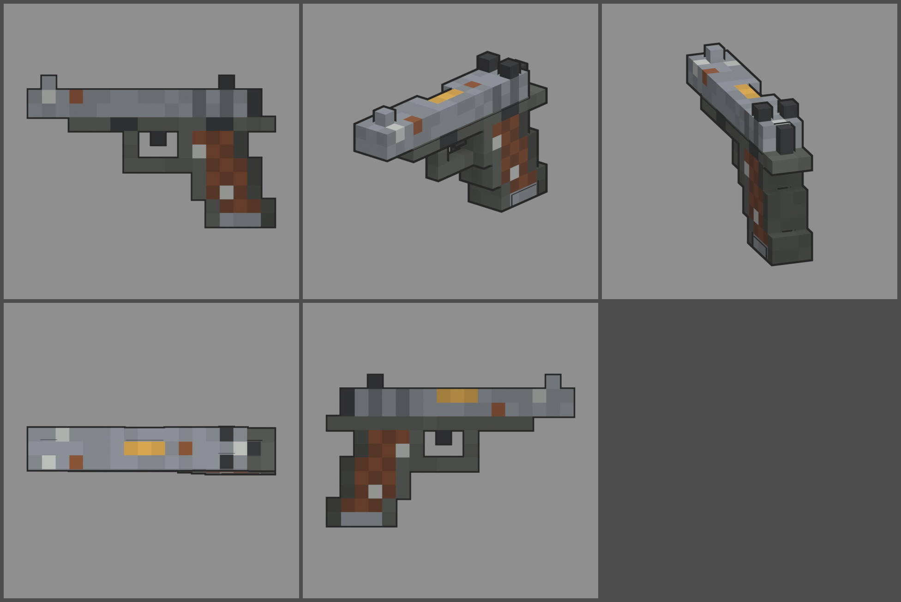

# Fiche d'arme — M1912 (pistolet de départ)

Statut : **validée le 2026-10-12**, intégrée au jeu. Refonte des armes du
2026-10-12 : armes réelles de référence, noms proches des vrais, cubes de
1,25 cm, pièces visibles. Les statistiques sont celles du jeu (`WeaponDB`,
GAME_CONCEPT § 4.9).

*Ligne du haut : profil gauche, trois-quarts, vue du tireur. Ligne du bas :
dessus, profil droit.*

## Identité

| | |
|---|---|
| Référence réelle | Colt M1911A1, .45 ACP, 7 coups (1911) |
| Nom affiché (FR / EN) | **M1912** / **M1912** |
| Identifiant interne | `m1911` (inchangé : profils, sons, tests) |
| Famille | pistolet |
| Niveau de base | 1 — **arme de base** (commune, donnée à tous, § 4.10) |
| Rôle | pistolet de départ : fiable, mais peu de munitions et une cadence lente |

Nom : on change un chiffre de la désignation réelle. « 1911 » est déjà
une désignation générique, fabriquée par des dizaines de marques, donc le
vrai nom serait aussi peu risqué. On garde quand même la règle des noms
proches.

## Statistiques

| Statistique | Valeur | Ancienne PÉTOIRE | Pourquoi |
|---|---|---|---|
| Dégâts par balle | **30** | 25 | grosse balle de .45 |
| Multiplicateur de tête | × 3 (90) | × 3 | famille pistolet |
| Cadence | **360** coups/min, semi-automatique | 400 | gros recul entre deux coups |
| Dégâts par seconde (corps) | 180 | 167 | à peine plus fort ; il reste une arme de départ |
| Chargeur / réserve | **7 / 70** | 8 / 80 | 7 coups comme le vrai, 10 chargeurs de réserve |
| Rechargement | **1,7 s** | 1,6 s | chargeur à une rangée |
| Précision à la hanche | dispersion **1,8°** (+ 0,7° par tir enchaîné) | 1,6° / 0,6° | recul plus sec |
| Précision en visée | 0° (balle au centre) | 0° | |
| Recul | montée **2,2°**, latéral ± 0,5°, 75 % rendu | 1,8° | .45 ACP |
| Portée (début de la perte de dégâts) | **22 m** | 25 m | arme de poing |
| Pénétration | 1 zombie | 1 | |
| Mobilité | 100 % | 100 % | |
| Mise en joue | 0,15 s, zoom × 0,85 | idem | |

Dégâts par niveau : + 10 % du dégât de base par niveau (§ 4.9). Repères :
un zombie de la manche 1 (150 PV) meurt en 5 balles au corps ou en 2 à la
tête ; un zombie de la manche 5 (550 PV) en 19 au corps.

## Pièces (emplacements et points d'attache)

Les pièces sont **visibles** sur l'arme, en cubes de 1,25 cm. Chaque arme
liste les familles qu'elle accepte, et chaque famille a un point d'attache
dans le modèle (`weapons_voxel.json`, `att_*`).

| Famille | Exemples pour cette arme | Point d'attache |
|---|---|---|
| Canon | compensateur, silencieux (canon fileté) | `att_muzzle` : bouche, en haut de la face avant |
| Viseur | micro point rouge sur la glissière | `att_optic` : dessus de la glissière, devant la hausse |
| Chargeur | chargeur long de 10 coups, qui dépasse de la poignée | `att_mag` : semelle du chargeur |
| Crosse (plaquettes) | plaquettes caoutchouc, plaquettes de nacre | `att_grip_l` / `att_grip_r` : flancs de la poignée |
| Culasse | détente de match, ressort renforcé | aucun (pas de modèle, statistiques seulement) |
| Accessoire | aucun : pas de rail sous le canon | |

Les modèles de pièces seront dessinés dans une itération à part, commune à
toutes les armes de la famille.

## Design

- **Cubes de 1,25 cm** (deux fois plus fins que les personnages).
  216 × 135 mm réels donnent **18 × 11 cubes**, avec une glissière de 3 cubes
  de large (un peu plus épaisse que la vraie, pour centrer guidon et cran).
- **Glissière** en acier usé, avec quelques taches de rouille et éclats
  clairs sur les arêtes. Stries arrière sombres. Fenêtre d'éjection sur le
  flanc droit, avec le canon de laiton visible au fond. Bouche : bague du
  canon en haut, bouchon du ressort en dessous.
- **Carcasse** parkérisée (gris-vert sombre) : cache-poussière, pontet
  carré, détente pleine. Arrêtoir de culasse et sûreté peints sur le flanc
  gauche. Chien à crête et queue de castor courte.
- **Poignée inclinée** comme le vrai (escalier d'un cube toutes les trois
  rangées). Plaquettes de noyer légèrement quadrillées, avec une vis en
  haut et une en bas. Semelle du chargeur en acier visible en bas.
- **Organes de visée** : guidon d'un cube, hausse à deux oreilles
  (convention du jeu, alignement vérifié en visée).
- **Pièces mobiles** : glissière (`slide`), chargeur (`mag`, caché dans la
  poignée, il sort dans l'axe incliné).
- **Budget** : 788 triangles (l'ancienne PÉTOIRE en avait 252).

## Vue FPS

Les mains (cubes de 2,5 cm, communes à toutes les armes) gardent la tenue
des pistolets : poing droit sur la poignée, main gauche qui l'enveloppe. Le
poing suit l'inclinaison de la poignée (`grip_angle` ≈ −16°, même axe que la
sortie du chargeur `mag_dir`). Contrôles : mains posées sur l'arme
(`test_view_model_fit`), cran et guidon au centre à 0,00 px en visée
(`weapon_aim`), glissière qui recule au tir, chargeur qui sort et revient
dans l'axe incliné (`weapon_view`).

## Intégration (faite le 2026-10-12)

- Modèle branché (`tools/blender/weapons/weapons_fine.py m1911 --export`),
  tenue des mains réglée dans la vue FPS, rendu du hub refait.
- Statistiques et nom dans `WeaponDB`.
- Règles et contrôles : troisième échelle de 1,25 cm pour les armes
  (GAME_CONCEPT § 4.19, ART_DIRECTION), `voxel_check` sur cette grille,
  noms proches des vrais (§ 4.9, `test_original_names`), budget de 5 000
  triangles pour les armes fines.

## Reste à faire

- Modèles des pièces visibles (itération commune à la famille pistolet).
