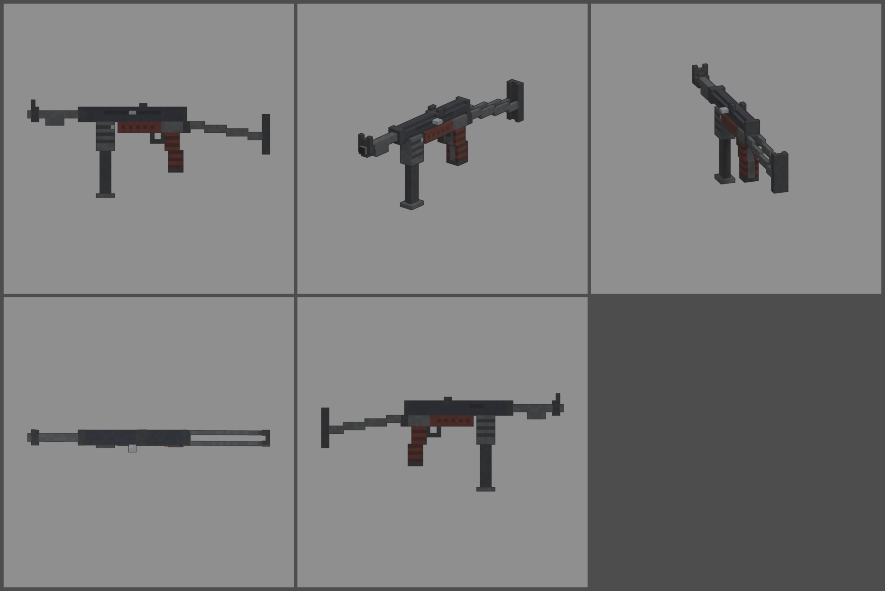

# Fiche d'arme — MR-40 (mitraillette)

Statut : **validée le 2026-10-12**, intégrée au jeu. Refonte des armes du 2026-10-12 : armes
réelles de référence, noms proches des vrais, cubes de 1,25 cm, pièces
visibles. Statistiques du jeu (`WeaponDB`, GAME_CONCEPT § 4.9).

*Ligne du haut : profil gauche, trois-quarts, vue du tireur. Ligne du bas :
dessus, profil droit.*

## Identité

| | |
|---|---|
| Référence réelle | MP40, 9 × 19 mm, chargeur droit de 32 (1940) |
| Nom affiché (FR / EN) | **MR-40** / **MR-40** |
| Identifiant interne | `mp40` (inchangé) |
| Famille | mitraillette |
| Niveau de base | 1 (inchangé) : la première arme de butin |
| Rôle | vieille mitraillette lente et docile : peu de dégâts, mais facile à tenir et un gros chargeur |

Nom : on change une lettre de la désignation réelle. « MP 41 » et « MP 44 »
sont d'autres armes réelles, on les évite. Aucun marquage d'époque sur le
modèle.

## Statistiques

| Statistique | Valeur | Ancienne CRÉCELLE | Pourquoi |
|---|---|---|---|
| Dégâts par balle | **90** | 90 | 9 mm |
| Multiplicateur de tête | × 2 | × 2 | famille |
| Cadence | **540** coups/min, automatique | 550 | cadence réelle (500 à 550) |
| Dégâts par seconde (corps) | 810 | 825 | |
| Chargeur / réserve | **32 / 192** | 32 / 192 | 6 chargeurs de réserve |
| Rechargement | **2,4 s** | 2,3 s | long chargeur droit à enfoncer dans son puits |
| Précision à la hanche | dispersion **3,0°** (+ 0,25° par tir enchaîné) | 3,0° / 0,3° | cadence lente : la dispersion grimpe peu |
| Précision en visée | 0° | 0° | |
| Recul | montée **0,8°**, latéral ± 0,4°, 60 % rendu | 0,9° | la plus docile des armes automatiques |
| Portée (début de la perte de dégâts) | **18 m** | 18 m | famille |
| Pénétration | 1 zombie | 1 | |
| Mobilité | 100 % | 100 % | |
| Mise en joue | 0,18 s, zoom × 0,85 | idem | |

Repère : au niveau 1, un zombie de la manche 1 (150 PV) tombe en 2 balles,
et un zombie de la manche 3 (350 PV) en 4.

## Pièces (emplacements et points d'attache)

| Famille | Exemples pour cette arme | Point d'attache |
|---|---|---|
| Canon | silencieux, compensateur | `att_muzzle` : bout du canon |
| Viseur | point rouge sur un pontet de montage | `att_optic` : dessus du boîtier |
| Chargeur | double chargeur accolé, chargeur long | `att_mag` : puits du chargeur |
| Crosse | crosse repliée (mobilité +, précision −), sangle | `att_stock` : charnière de la crosse |
| Culasse | ressort renforcé, culasse allégée | aucun (statistiques seulement) |
| Accessoire | aucun : pas de rail ni de garde-main | |

## Design (version 2, plus massive)

- **67 cubes de long** (833 mm, crosse dépliée), 1,25 cm par cube.
- **Largeurs paires** : l'axe du canon passe entre deux colonnes de cubes.
  On peut ainsi avoir un canon de 2 × 2 cubes (25 mm) et un boîtier rond de
  4 × 4 cubes aux coins abattus, au lieu d'une croix de 3. Le guidon et le
  cran font 2 cubes de large et restent centrés.
- **Avant** :
  - guidon de 2 cubes entre deux oreilles de protection, sur une bague
    autour du canon ;
  - **arrêtoir d'appui** sous le canon, la barre qui servait à poser l'arme
    sur le bord d'un véhicule ;
  - écrou de canon devant le boîtier.
- **Boîtier** bleu-noir, avec un bouchon plein à l'arrière et la hausse
  posée dessus (deux oreilles, cran de 2 cubes).
- **Flanc gauche** : longue fente du levier d'armement, levier qui dépasse.
  **Flanc droit** : fenêtre d'éjection.
- **Dessous** :
  - **long puits du chargeur** nervuré (8 rangées, 10 cm), avec le bouton de
    déverrouillage ;
  - **chargeur droit de 32** (2 × 3 cubes, 25 cm), qui dépasse de 15 cm ;
  - **carcasse** sous le boîtier : l'avant en bakélite brun-rouge nervurée,
    l'arrière en acier ;
  - pontet et détente.
- **Poignée** massive : carcasse d'acier au centre et plaquettes de
  bakélite nervurées sur les flancs, légèrement inclinée.
- **Crosse dépliée** : charnière sous le bouchon, deux bras emboutis de 2
  rangées qui descendent vers une plaque de couche en U.
- **Pièces mobiles** : chargeur (`mag`, il sort tout droit), levier
  d'armement (`slide`).
- **Budget** : 2 446 triangles.
- **Main d'appui** : comme sur le vrai MP40, elle tient le puits du
  chargeur (« Vue FPS »).

## Vue FPS

Poing droit sur la poignée, qui suit sa légère inclinaison (`grip_angle`
≈ −11°, un cube toutes les cinq rangées). **Main gauche sur le puits du
chargeur** : poing vertical (`front_grip`, pièce `foregrip` des mains) dont
le haut est juste sous le boîtier (`support` en (0 ; −1 ; −15,5) cubes) ;
le creux du poing (3,75 cm, mains à la taille réelle) serre le puits de
5 cm de large.
**Largeurs paires** : l'axe du canon passe entre les colonnes −1 et 0
(x = 0) ; cran et guidon de 2 cubes restent centrés (0,00 px en visée,
`weapon_aim`) ; pavés sur la grille de 1,25 cm sans décalage
(`voxel_check`, `test_even_width_fine_model`). Chargeur qui sort tout droit
et revient (`weapon_view`).

## Intégration (faite le 2026-10-12)

- Modèle branché (`weapons_fine.py mp40 --export`, ancien modèle retiré de
  `weapons_voxel.py`), tenue des mains réglée, rendu du hub refait.
- Statistiques, nom et référence réelle (« Réf. MP40 ») dans `WeaponDB`.

## Reste à faire

- Modèles des pièces visibles (itération commune à la famille).
