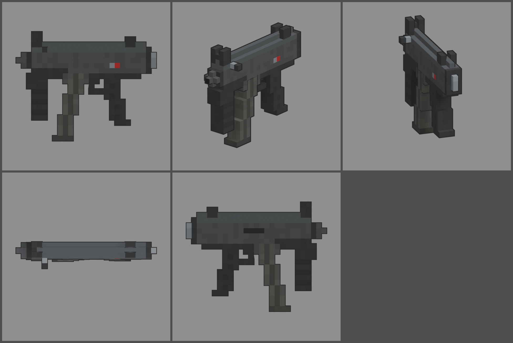

# Fiche d'arme — MK-5K (mitraillette compacte)

Statut : **proposition, à valider**. Refonte des armes du 2026-10-12 : armes
réelles de référence, noms proches des vrais, cubes de 1,25 cm, pièces
visibles. Statistiques du jeu (`WeaponDB`, GAME_CONCEPT § 4.9).

*Ligne du haut : profil gauche, trois-quarts, vue du tireur. Ligne du bas :
dessus, profil droit.*

## Identité

| | |
|---|---|
| Référence réelle | MP5K, 9 × 19 mm, chargeur courbe de 30, sans crosse (1976) |
| Nom affiché (FR / EN) | **MK-5K** / **MK-5K** |
| Identifiant interne | `mp5k` (inchangé) |
| Famille | mitraillette |
| Niveau de base | 7 (inchangé) |
| Rôle | arme de poing automatique : très rapide et très maniable, mais nerveuse et de courte portée |

Nom : on change une lettre (P → K). On ne reprend pas le nom du fabricant,
ni la désignation « MP5 », qui est une marque.

## Statistiques

| Statistique | Proposition | Ancien MOUCHERON | Pourquoi |
|---|---|---|---|
| Dégâts par balle | **70** | 70 | 9 mm |
| Multiplicateur de tête | × 2 | × 2 | famille |
| Cadence | **900** coups/min, automatique | 800 | cadence réelle |
| Dégâts par seconde (corps) | 1 050 | 933 | MR-40 (niveau 1) : 810 |
| Chargeur / réserve | **30 / 150** | 30 / 120 | 5 chargeurs de réserve ; le chargeur se vide en 2 s |
| Rechargement | **2,3 s** | 2,1 s | |
| Précision à la hanche | dispersion **3,2°** (+ 0,35° par tir enchaîné) | 3,0° / 0,3° | sans crosse |
| Précision en visée | 0° | 0° | |
| Recul | montée **1,1°**, latéral ± 0,6° | 0,9° | sans crosse, la poignée avant aide |
| Portée (début de la perte de dégâts) | **15 m** | 18 m | canon très court |
| Pénétration | 1 zombie | 1 | |
| Mobilité | 100 % | 100 % | |
| Mise en joue | **0,15 s**, zoom × 0,85 | 0,18 s | la plus rapide à épauler |

Repère : au niveau 7, une balle fait 112 dégâts. Un zombie de la manche 7
(750 PV) tombe en 7 balles au corps.

## Pièces (emplacements et points d'attache)

| Famille | Exemples pour cette arme | Point d'attache |
|---|---|---|
| Canon | silencieux, compensateur sur les ergots du canon | `att_muzzle` : bout du canon |
| Viseur | point rouge sur un rail à griffes | `att_optic` : dessus du tube d'armement |
| Chargeur | chargeur de 40, double chargeur accolé | `att_mag` : puits du chargeur |
| Crosse | crosse repliable (précision +, mobilité −) | `att_stock` : bouchon arrière |
| Accessoire | lampe dans la poignée avant, poignée avant plus longue | `att_rail` : poignée avant |
| Culasse | rafale de 2 ou de 3, ressort allégé (cadence +) | aucun (statistiques seulement) |

## Design

- **26 cubes de long** (325 mm), 1,25 cm par cube : la plus petite arme à
  deux mains du jeu.
- **Boîtier** embouti gris très foncé de 3 cubes de large.
  - **Dessus** : tube d'armement arrondi. Le levier d'armement dépasse à
    gauche, à l'avant (pièce mobile `slide`).
  - **Organes de visée** bas, comme sur le vrai : guidon entre deux
    oreilles à l'avant, hausse à tambour à l'arrière, à peine 2,5 cm
    au-dessus du tube.
  - **Flancs** : fenêtre d'éjection à droite ; sélecteur à gauche, avec son
    repère rouge.
- **Avant** : canon court à ergots (section en croix) devant l'écrou.
- **Dessous** :
  - **garde-main** court et **poignée avant verticale** en polymère noir
    strié, tout à l'avant, avec sa butée qui empêche la main de passer
    devant le canon ; un vrai jour la sépare du chargeur ;
  - **chargeur de 30** gris acier, courbé, nervuré, avec sa semelle ;
  - carcasse et **poignée** en polymère, inclinée, pontet.
- **Arrière** : bouchon et anneau de sangle (pas de crosse).
- **Pièces mobiles** : chargeur (`mag`, il sort dans l'axe de sa courbe),
  levier d'armement (`slide`).
- **Budget** : 1 028 triangles.
