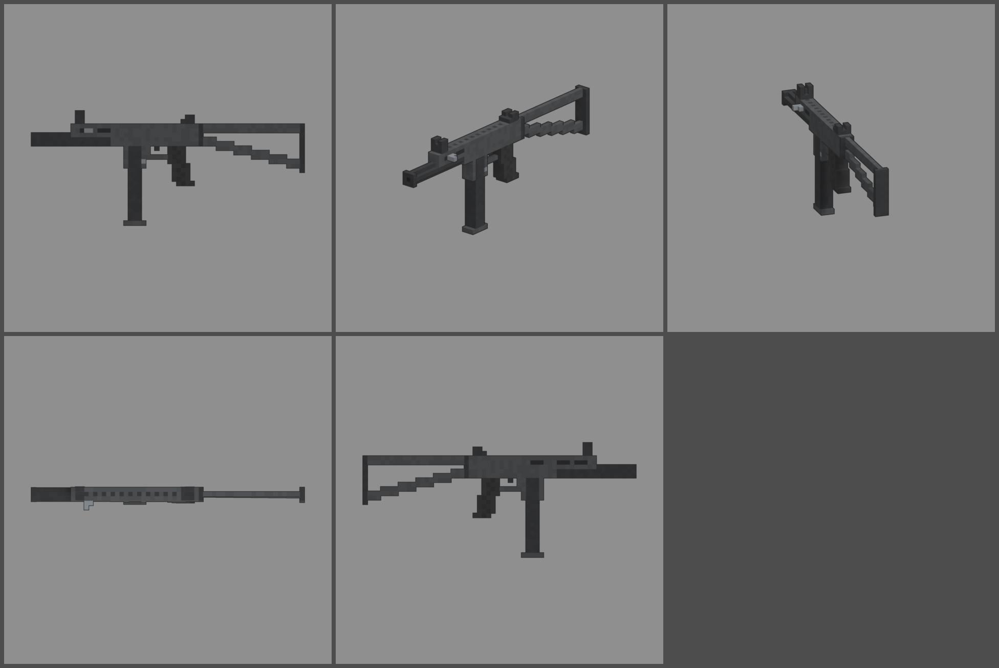

# Fiche d'arme — MTL (mitraillette)

Statut : **proposition, à valider**. Refonte des armes du 2026-10-12 : armes
réelles de référence, noms proches des vrais, cubes de 1,25 cm, pièces
visibles. Statistiques du jeu (`WeaponDB`, GAME_CONCEPT § 4.9).

*Ligne du haut : profil gauche, trois-quarts, vue du tireur. Ligne du bas :
dessus, profil droit.*

## Identité

| | |
|---|---|
| Référence réelle | Walther MPL, 9 × 19 mm, chargeur droit de 32, canon long (1963) |
| Nom affiché (FR / EN) | **MTL** / **MTL** |
| Identifiant interne | `mpl` (inchangé) |
| Famille | mitraillette |
| Niveau de base | 11 (inchangé) |
| Rôle | mitraillette lourde et posée : cadence lente, balles qui portent loin pour une mitraillette, très facile à tenir |

Nom : on change une lettre (P → T). On ne reprend pas le nom du fabricant.

## Statistiques

| Statistique | Proposition | Ancienne AGRAFEUSE | Pourquoi |
|---|---|---|---|
| Dégâts par balle | **115** | 75 | 9 mm, canon long |
| Multiplicateur de tête | × 2 | × 2 | famille |
| Cadence | **580** coups/min, automatique | 900 | cadence réelle (550) |
| Dégâts par seconde (corps) | 1 112 | 1 125 | PN-63 (niveau 9) : 1 029 |
| Chargeur / réserve | **32 / 192** | 24 / 192 | 32 coups comme la vraie, 6 chargeurs de réserve |
| Rechargement | **2,3 s** | 2,0 s | long chargeur droit |
| Précision à la hanche | dispersion **2,8°** (+ 0,25° par tir enchaîné) | 3,0° | arme lourde, cadence lente |
| Précision en visée | 0° | 0° | |
| Recul | montée **0,9°**, latéral ± 0,4° | 0,9° | très docile |
| Portée (début de la perte de dégâts) | **20 m** | 18 m | canon long (version « L ») |
| Pénétration | 1 zombie | 1 | |
| Mobilité | 100 % | 100 % | |
| Mise en joue | 0,18 s, zoom × 0,85 | idem | |

Repère : au niveau 11, une balle fait 230 dégâts. Un zombie de la manche 11
(1 150 PV) tombe en 5 balles au corps.

## Pièces (emplacements et points d'attache)

| Famille | Exemples pour cette arme | Point d'attache |
|---|---|---|
| Canon | silencieux, compensateur | `att_muzzle` : bague de bouche |
| Viseur | point rouge sur la nervure du dessus | `att_optic` : dessus du boîtier |
| Chargeur | chargeur de 40, double chargeur accolé | `att_mag` : bas du puits du chargeur |
| Crosse | crosse repliée (mobilité +, précision −), plaque caoutchouc | `att_stock` : bouchon arrière |
| Accessoire | lampe, poignée sous l'avant du boîtier | `att_rail` : sous la fenêtre avant |
| Culasse | ressort allégé (cadence +), culasse lourde (recul −) | aucun (statistiques seulement) |

## Design

- **61 cubes de long** (746 mm, crosse dépliée), 1,25 cm par cube, 3 cubes
  de large.
- **Boîtier embouti haut**, gris très foncé : la culasse coulisse au-dessus
  du canon. L'avant du boîtier est **ouvert dessous** et laisse voir le
  canon. **Évidements** emboutis sur les flancs, nervure striée sur le
  dessus.
- **Canon long** à section en croix (3 cubes, pour ne pas paraître
  fragile) qui dépasse devant le boîtier, bague pleine à la bouche.
- **Organes de visée** : guidon entre deux oreilles à l'avant, hausse à
  l'arrière.
- **Flancs** : fenêtre d'éjection à droite ; levier d'armement à gauche
  (pièce mobile `slide`).
- **Puits du chargeur** devant le pontet, avec le bouton de
  déverrouillage. Le **chargeur droit de 32** noir dépasse dessous.
- **Pontet**, détente, **poignée** en polymère noir quadrillé, inclinée.
- **Crosse en tube coudé** dépliée : bras haut droit, bras bas qui
  descend, plaque de couche.
- **Pièces mobiles** : levier d'armement (`slide`), chargeur (`mag`, sort
  tout droit).
- **Budget** : 1 704 triangles.
