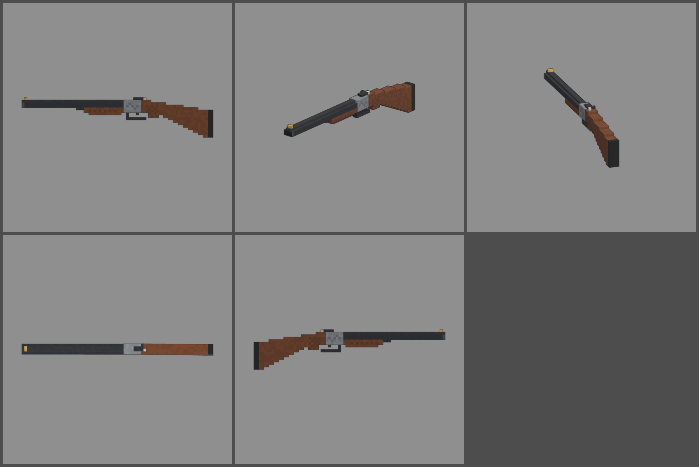

# Fiche d'arme — IZ-43 (fusil à deux canons)

Statut : **validée le 2026-10-12, à intégrer en jeu (lot 2)**. Refonte des armes du 2026-10-12 : armes
réelles de référence, noms proches des vrais, cubes de 1,25 cm, pièces
visibles. Statistiques du jeu (`WeaponDB`, GAME_CONCEPT § 4.9).

*Ligne du haut : profil gauche, trois-quarts, vue du tireur. Ligne du bas :
dessus, profil droit.*

## Identité

| | |
|---|---|
| Référence réelle | IJ-43 (IZh-43), fusil de chasse à canons juxtaposés, calibre 12, canons de 510 mm |
| Nom affiché (FR / EN) | **IZ-43** / **IZ-43** |
| Identifiant interne | `olympia` (inchangé) |
| Famille | fusil à pompe (famille « shotgun » du jeu) |
| Niveau de base | 3 (inchangé) |
| Rôle | le fusil du garde-chasse : deux coups dévastateurs de près, puis on recharge |

Nom : on retire une lettre de la désignation réelle. On ne reprend pas
« Baikal », la marque du fabricant.

## Statistiques

| Statistique | Proposition | Ancien GARDE-CHASSE | Pourquoi |
|---|---|---|---|
| Dégâts par plomb | **65 × 8 plombs** (520 par coup) | 60 × 8 | calibre 12 |
| Multiplicateur de tête | × 1,5 | × 1,5 | famille |
| Cadence | **240** coups/min (deux détentes, les deux coups s'enchaînent) | 200 | |
| Chargeur / réserve | **2 / 40** | 2 / 38 | deux canons, 20 recharges |
| Rechargement | **2,6 s** (on casse l'arme et on glisse deux cartouches) | 2,8 s | |
| Précision à la hanche | dispersion **7,0°** | 7,0° | gerbe large |
| Précision en visée | **5,0°** | 5,0° | |
| Recul | montée **5,5°**, latéral ± 1,0° | 5,0° | deux coups de calibre 12 |
| Portée (début de la perte de dégâts) | **9 m** | 8 m | canons longs |
| Pénétration | 1 zombie | 1 | |
| Mobilité | 100 % | 100 % | |
| Mise en joue | 0,2 s, zoom × 0,9 | idem | |

Repère : de près, un coup (8 plombs) tue un zombie jusqu'à la manche 4
(450 PV), les deux coups jusqu'à la manche 9 (950 PV).

## Pièces (emplacements et points d'attache)

| Famille | Exemples pour cette arme | Point d'attache |
|---|---|---|
| Canon | chokes (gerbe serrée ou large), canons sciés (mobilité +, portée −) | `att_muzzle` : bouches |
| Viseur | guidon fluorescent, petit point rouge sur la bande | `att_optic` : bande de visée |
| Crosse | plaque de couche épaisse, crosse sciée | `att_stock` : talon de la crosse |
| Accessoire | cartouchière sur la crosse, lampe sous les canons | `att_rail` : longuesse |
| Culasse | éjecteurs automatiques (rechargement plus rapide) | aucun (statistiques seulement) |
| Chargeur | aucun : deux canons | |

## Design

- **77 cubes de long** (960 mm), 1,25 cm par cube.
- **Largeurs paires** : les deux canons de 2 × 2 cubes (25 mm) sont côte à
  côte, et l'axe de l'arme passe entre eux.
- **Canons** bleu-noir avec des bagues un peu plus claires aux bouches.
  **Bande de visée** dans le creux entre les deux canons, **guidon-bille**
  en laiton au bout.
- **Longuesse** en noyer quadrillé sous les canons, avec son verrou.
- **Bascule** en acier gris avec une gravure discrète, **clé
  d'ouverture** sur le dessus, sûreté sur la queue.
- **Pontet** avec **deux détentes**, une par canon.
- **Crosse en noyer** : poignet fin, demi-poignée pistolet quadrillée, puis
  la crosse s'élargit jusqu'à une **plaque de couche en caoutchouc**.
- **Pièce mobile** : les canons, la bande et la longuesse forment la pièce
  `barrels`, qui bascule autour de la charnière pour le rechargement.
- **Budget** : 1 888 triangles.
