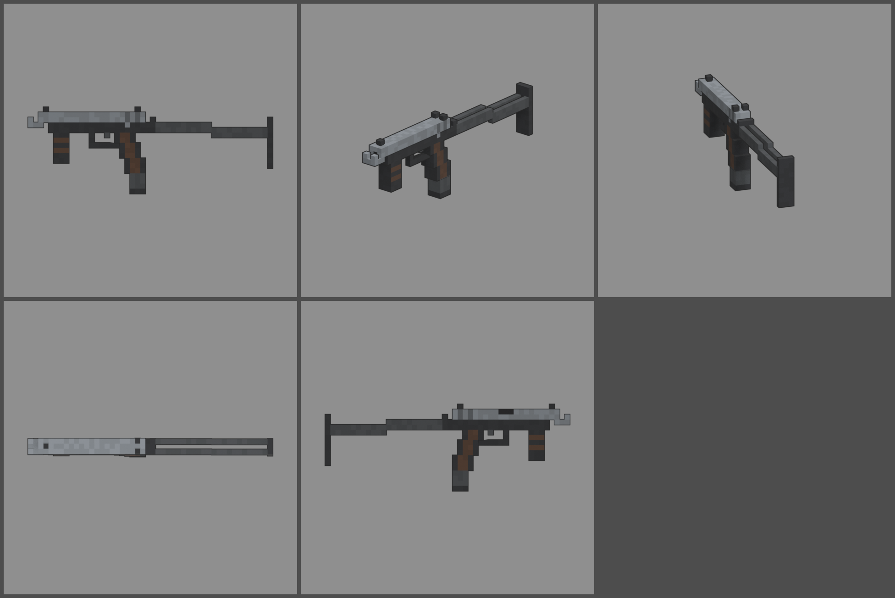

# Fiche d'arme — PN-63 (mitraillette-pistolet)

Statut : **validée le 2026-10-12, à intégrer en jeu (lot 2)**. Refonte des armes du 2026-10-12 : armes
réelles de référence, noms proches des vrais, cubes de 1,25 cm, pièces
visibles. Statistiques du jeu (`WeaponDB`, GAME_CONCEPT § 4.9).

*Ligne du haut : profil gauche, trois-quarts, vue du tireur. Ligne du bas :
dessus, profil droit.*

## Identité

| | |
|---|---|
| Référence réelle | PM-63 « RAK » (Pologne), 9 × 18 mm, chargeur de 25 dans la poignée (1963) |
| Nom affiché (FR / EN) | **PN-63** / **PN-63** |
| Identifiant interne | `pm63` (inchangé) |
| Famille | mitraillette |
| Niveau de base | 9 (inchangé) |
| Rôle | une mitraillette qui se manie comme un pistolet : très maniable, rechargement éclair, mais petite munition |

Nom : on change une lettre (M → N). On ne reprend pas le surnom « RAK ».

## Statistiques

| Statistique | Proposition | Ancienne PUCE | Pourquoi |
|---|---|---|---|
| Dégâts par balle | **95** | 70 | 9 × 18 mm, compensé par le niveau |
| Multiplicateur de tête | × 2 | × 2 | famille |
| Cadence | **650** coups/min, automatique | 1 000 | cadence réelle (réducteur de cadence) |
| Dégâts par seconde (corps) | 1 029 | 1 167 | MK-5K (niveau 7) : 1 050, mais celle-ci recharge bien plus vite |
| Chargeur / réserve | **25 / 150** | 20 / 100 | 25 coups comme le vrai, 6 chargeurs de réserve |
| Rechargement | **1,6 s** | 1,9 s | chargeur dans la poignée, comme un pistolet |
| Précision à la hanche | dispersion **2,6°** (+ 0,3° par tir enchaîné) | 3,0° | glissière lourde : cadence lente, tir tenu |
| Précision en visée | 0° | 0° | |
| Recul | montée **0,9°**, latéral ± 0,5° | 0,9° | le bec compensateur rabat le canon |
| Portée (début de la perte de dégâts) | **16 m** | 18 m | canon court |
| Pénétration | 1 zombie | 1 | |
| Mobilité | 100 % | 100 % | |
| Mise en joue | **0,14 s**, zoom × 0,85 | 0,18 s | légère comme un pistolet |

Repère : au niveau 9, une balle fait 171 dégâts. Un zombie de la manche 9
(950 PV) tombe en 6 balles au corps.

## Pièces (emplacements et points d'attache)

| Famille | Exemples pour cette arme | Point d'attache |
|---|---|---|
| Canon | silencieux à la place du bec, bec allongé (recul −) | `att_muzzle` : bouche, au-dessus du bec |
| Viseur | micro point rouge sur la carcasse | `att_optic` : dessus, devant la glissière |
| Chargeur | chargeur de 40, semelle allongée | `att_mag` : semelle du chargeur |
| Crosse | crosse repliée (mobilité +, précision −), plaque de couche caoutchouc | `att_stock` : charnière de la crosse |
| Accessoire | lampe sur la poignée avant | `att_rail` : poignée avant |
| Culasse | glissière allégée (cadence +), ressort renforcé | aucun (statistiques seulement) |

## Design

- **48 cubes de long** (583 mm, crosse dépliée), 1,25 cm par cube, 3 cubes
  de large.
- **Glissière** nue en acier clair, avec ses stries arrière, sa fenêtre
  d'éjection et le guidon et la hausse posés dessus. C'est la pièce mobile
  `slide` : sur la vraie arme, toute la glissière recule à chaque tir.
- **Bec compensateur** sous la bouche, avec deux petits rebords : la
  signature de la PM-63 (il rabat le canon et permet même d'armer en
  appuyant le bec sur une table).
- **Carcasse** noire. **Poignée avant** dépliée sous l'avant, à plaquettes
  brunes. Pontet arrondi.
- **Poignée** inclinée, plaquettes en polymère brun. Le **chargeur de 25**
  est au cœur de la poignée et dépasse de 3 rangées dessous.
- **Crosse en fil** dépliée : charnière, deux bras de 2 rangées qui
  descendent d'une rangée, plaque de couche.
- **Pièces mobiles** : glissière (`slide`), chargeur (`mag`, sort dans
  l'axe de la poignée).
- **Budget** : 1 436 triangles.
