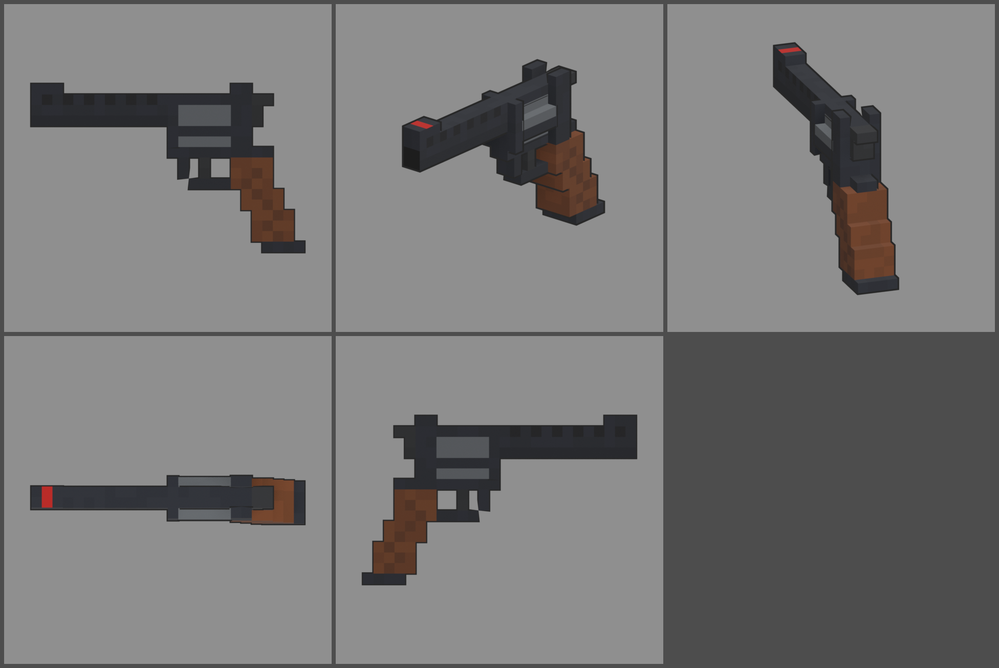

# Fiche d'arme — PYTHO .357 (revolver)

Statut : **validée le 2026-10-12, à intégrer en jeu (lot 2)**. Refonte des armes du 2026-10-12 : armes
réelles de référence, noms proches des vrais, cubes de 1,25 cm, pièces
visibles. Statistiques du jeu (`WeaponDB`, GAME_CONCEPT § 4.9).

*Ligne du haut : profil gauche, trois-quarts, vue du tireur. Ligne du bas :
dessus, profil droit.*

## Identité

| | |
|---|---|
| Référence réelle | Colt Python, .357 Magnum, 6 coups, canon de 6 pouces (1955) |
| Nom affiché (FR / EN) | **PYTHO .357** / **PYTHO .357** |
| Identifiant interne | `python` (inchangé) |
| Famille | revolver |
| Niveau de base | 20 (inchangé) |
| Rôle | le canon à main : chaque balle compte, une tête = un zombie, mais 6 coups et un rechargement long |

Nom : Python est une marque de Colt. On retire une lettre (Pytho, le
serpent de la mythologie) et on garde le calibre.

## Statistiques

| Statistique | Proposition | Ancien COUPERET | Pourquoi |
|---|---|---|---|
| Dégâts par balle | **450** | 400 | .357 Magnum |
| Multiplicateur de tête | × 2 | × 2 | famille revolver |
| Cadence | **160** coups/min, double action | 180 | détente lourde |
| Chargeur / réserve | **6 / 60** | 6 / 60 | barillet de 6, 10 pleins |
| Rechargement | **3,2 s** (barillet basculé, éjection, six cartouches) | 3,0 s | |
| Précision à la hanche | dispersion **1,6°** (+ 1,2° par tir enchaîné) | 1,8° | canon long, très précis le premier coup |
| Précision en visée | 0° | 0° | |
| Recul | montée **4,5°**, latéral ± 0,9° | 4,5° | gros calibre |
| Portée (début de la perte de dégâts) | **30 m** | 30 m | canon de 6 pouces |
| Pénétration | **3 zombies** | 3 | |
| Mobilité | 100 % | 100 % | |
| Mise en joue | 0,18 s, zoom × 0,8 | idem | |

Repère : au niveau 20, une balle fait 1 305 dégâts. Un zombie de la manche
20 (2 050 PV) tombe en 2 balles au corps, ou en une seule à la tête.

## Pièces (emplacements et points d'attache)

| Famille | Exemples pour cette arme | Point d'attache |
|---|---|---|
| Canon | compensateur, canon long de 8 pouces (portée +, mise en joue −) | `att_muzzle` : bouche |
| Viseur | lunette de poing sur la bande ventilée | `att_optic` : bande ventilée |
| Crosse (plaquettes) | plaquettes caoutchouc (recul −), plaquettes de bois précieux | `att_grip_l` / `att_grip_r` : flancs de la poignée |
| Accessoire | lampe sous le tenon | `att_rail` : sous le canon |
| Chargeur | chargeur rapide (« speedloader », rechargement +) | aucun point : le barillet est visible |
| Culasse | détente adoucie (cadence +) | aucun (statistiques seulement) |

## Design

- **26 cubes de long** (292 mm), 1,25 cm par cube. **Largeurs paires** :
  canon de 2 cubes, barillet et poignée de 4.
- **Signatures du Python** :
  - **bande ventilée** sur le canon, avec ses fenêtres sombres sur toute la
    longueur ;
  - **tenon plein** sous le canon jusqu'à la bouche (rangée basse du canon,
    plus sombre) ;
  - guidon en rampe avec son insert rouge.
- **Carcasse** bleu nuit autour du barillet : pont supérieur, avant, fond
  et bouclier arrière ; hausse à deux oreilles sur le pont.
- **Barillet** d'acier (4 × 4 aux coins abattus), plus haut que le canon,
  avec ses cannelures sur toute la longueur : la pièce mobile `cyl`, qui
  bascule à gauche pour le rechargement.
- **Chien à crête** derrière la hausse, sous la ligne de mire.
- **Pontet** arrondi, détente.
- **Poignée** en noyer quadrillé, très inclinée, culot d'acier.
- **Budget** : 724 triangles.
