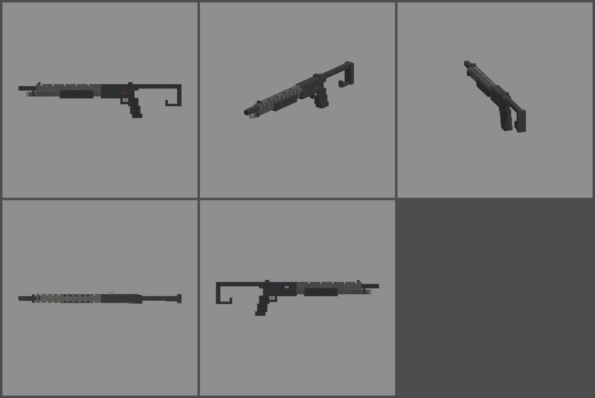

# Fiche d'arme — SPAX-12 (fusil à pompe de combat)

Statut : **proposition, à valider**. Refonte des armes du 2026-10-12 : armes
réelles de référence, noms proches des vrais, cubes de 1,25 cm, pièces
visibles. Statistiques du jeu (`WeaponDB`, GAME_CONCEPT § 4.9).

*Ligne du haut : profil gauche, trois-quarts, vue du tireur. Ligne du bas :
dessus, profil droit.*

## Identité

| | |
|---|---|
| Référence réelle | Franchi SPAS-12, calibre 12, tube de 8, crosse repliable (1979) |
| Nom affiché (FR / EN) | **SPAX-12** / **SPAX-12** |
| Identifiant interne | `spas12` (inchangé) |
| Famille | fusil à pompe |
| Niveau de base | 14 (inchangé) |
| Rôle | le fusil à pompe lourd : 8 cartouches, gerbe serrée, frappe fort, mais lent à recharger |

Nom : on change une lettre de l'acronyme (S → X), sans la marque Franchi.

## Statistiques

| Statistique | Proposition | Ancien CONCASSEUR | Pourquoi |
|---|---|---|---|
| Dégâts par plomb | **75 × 8 plombs** (600 par coup) | 70 × 8 | calibre 12, canon long |
| Multiplicateur de tête | × 1,5 | × 1,5 | famille |
| Cadence | **100** coups/min, pompe | 90 | pompe courte |
| Chargeur / réserve | **8 / 48** | 8 / 32 | tube de 8 comme le vrai, 6 pleins de réserve |
| Rechargement | **3,4 s** (cartouche par cartouche) | 3,0 s | 8 cartouches à glisser |
| Précision à la hanche | dispersion **6,5°** | 6,5° | |
| Précision en visée | **4,5°** | 4,0° | gerbe serrée pour un fusil à pompe |
| Recul | montée **5,0°**, latéral ± 1,0° | 5,0° | lourd, absorbe bien |
| Portée (début de la perte de dégâts) | **10 m** | 8 m | canon de 550 mm |
| Pénétration | 1 zombie | 1 | |
| Mobilité | 95 % | 100 % | 4,4 kg |
| Mise en joue | **0,22 s**, zoom × 0,9 | 0,2 s | |

Repère : au niveau 14, un coup fait 1 380 dégâts de près. Un zombie de la
manche 13 (1 350 PV) meurt d'un coup, celui de la manche 14 (1 450 PV)
presque.

## Pièces (emplacements et points d'attache)

| Famille | Exemples pour cette arme | Point d'attache |
|---|---|---|
| Canon | choke serré, bec de canard (gerbe aplatie) | `att_muzzle` : bouche du canon |
| Viseur | point rouge sur le boîtier | `att_optic` : dessus du boîtier |
| Crosse | crosse repliée (mobilité +, précision −), crosse fixe | `att_stock` : plaque de couche |
| Accessoire | lampe ou cartouchière sur la pompe | `att_rail` : pompe |
| Chargeur | rallonge de tube (+ 2 cartouches) | aucun point : le tube est visible sous le manchon |
| Culasse | mode semi-automatique (cadence +, comme le vrai SPAS-12) | aucun (statistiques seulement) |

## Design

- **83 cubes de long** (1 041 mm, crosse dépliée), 1,25 cm par cube.
  **Largeurs paires** : canon et tube magasin de 2 × 2 cubes.
- **Manchon ajouré** gris phosphaté autour du canon (tube de 4 aux coins
  abattus), percé sur les flancs et le dessus : on voit le canon noir à
  travers. Guidon au bout du manchon, canon qui dépasse devant.
- **Tube magasin** dessous, son collier et son bouchon d'acier.
- **Pompe** en polymère noir nervuré autour du tube : la pièce mobile
  `pump`.
- **Boîtier** noir haut. **Flanc droit** : fenêtre d'éjection et levier
  d'armement. **Dessous** : fenêtre de chargement. **Flanc gauche** :
  sûreté rouge. Hausse à deux oreilles à l'arrière.
- **Pontet**, détente, **grosse poignée pistolet** en polymère nervuré
  (5 cubes de profondeur).
- **Crosse en tôle dépliée** : charnière, barre haute, plaque de couche, et
  le **crochet d'avant-bras** sous la plaque, la signature du SPAS-12.
- **Pièces mobiles** : pompe (`pump`), levier d'armement (`slide`).
- **Budget** : 2 342 triangles.
