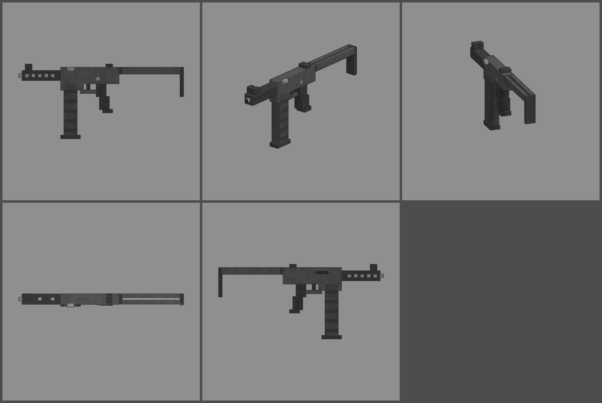

# Fiche d'arme — SPETTRO M4 (mitraillette)

Statut : **proposition, à valider**. Refonte des armes du 2026-10-12 : armes
réelles de référence, noms proches des vrais, cubes de 1,25 cm, pièces
visibles. Statistiques du jeu (`WeaponDB`, GAME_CONCEPT § 4.9).

*Ligne du haut : profil gauche, trois-quarts, vue du tireur. Ligne du bas :
dessus, profil droit.*

## Identité

| | |
|---|---|
| Référence réelle | SITES Spectre M4 (Italie), 9 × 19 mm, chargeur de 50 à quatre rangées (1983) |
| Nom affiché (FR / EN) | **SPETTRO M4** / **SPETTRO M4** |
| Identifiant interne | `spectre` (inchangé) |
| Famille | mitraillette |
| Niveau de base | 16 (inchangé) |
| Rôle | la mitraillette « tuyau d'arrosage » : énorme chargeur de 50, on tire longtemps sans recharger |

Nom : « spettro » est le mot italien pour « spectre ». On ne reprend pas
la marque SITES.

## Statistiques

| Statistique | Proposition | Ancien FEU FOLLET | Pourquoi |
|---|---|---|---|
| Dégâts par balle | **90** | 80 | 9 mm |
| Multiplicateur de tête | × 2 | × 2 | famille |
| Cadence | **850** coups/min, automatique | 950 | cadence réelle |
| Dégâts par seconde (corps) | 1 275 | 1 267 | |
| Chargeur / réserve | **50 / 200** | 30 / 120 | 50 coups comme le vrai : 3,5 s de tir continu |
| Rechargement | **2,8 s** | 2,2 s | chargeur très épais |
| Précision à la hanche | dispersion **3,0°** (+ 0,3° par tir enchaîné) | 3,0° | |
| Précision en visée | 0° | 0° | |
| Recul | montée **1,0°**, latéral ± 0,5° | 0,9° | |
| Portée (début de la perte de dégâts) | **18 m** | 18 m | |
| Pénétration | 1 zombie | 1 | |
| Mobilité | 100 % | 100 % | |
| Mise en joue | 0,18 s, zoom × 0,85 | idem | |

Repère : au niveau 16, une balle fait 225 dégâts. Un zombie de la manche
16 (1 650 PV) tombe en 8 balles au corps ; un chargeur en tue 6.

## Pièces (emplacements et points d'attache)

| Famille | Exemples pour cette arme | Point d'attache |
|---|---|---|
| Canon | silencieux, compensateur | `att_muzzle` : bout du canon |
| Viseur | point rouge sur le boîtier | `att_optic` : dessus du boîtier |
| Chargeur | double chargeur accolé (100 coups), semelle allongée | `att_mag` : semelle du chargeur |
| Crosse | crosse repliée par-dessus (mobilité +, précision −) | `att_stock` : charnière de la crosse |
| Accessoire | poignée avant, lampe sous le manchon | `att_rail` : sous le manchon |
| Culasse | ressort allégé (cadence +) | aucun (statistiques seulement) |

## Design

- **50 cubes de long** (580 mm, crosse dépliée), 1,25 cm par cube, 3 cubes
  de large.
- **Boîtier** gris très foncé : fenêtre d'éjection à droite, sélecteur à
  gauche, **bouton d'armement** sur le dessus à gauche (pièce mobile
  `slide`).
- **Manchon ajouré** noir devant le boîtier, percé sur les flancs et le
  dessus : on voit le canon d'acier dedans. Guidon bas entre deux oreilles
  au bout du manchon, hausse à l'arrière du boîtier.
- **Chargeur de 50 à quatre rangées**, la signature de la Spectre : très
  épais (3 cubes) et très long, nervuré, semelle noire.
- **Pontet**, détente, **poignée** en polymère nervuré, inclinée.
- **Crosse en fil** dépliée au ras du dessus (elle se replie par-dessus
  le boîtier), deux bras de 2 rangées et plaque de couche.
- **Pièces mobiles** : bouton d'armement (`slide`), chargeur (`mag`, sort
  tout droit).
- **Budget** : 1 514 triangles.
