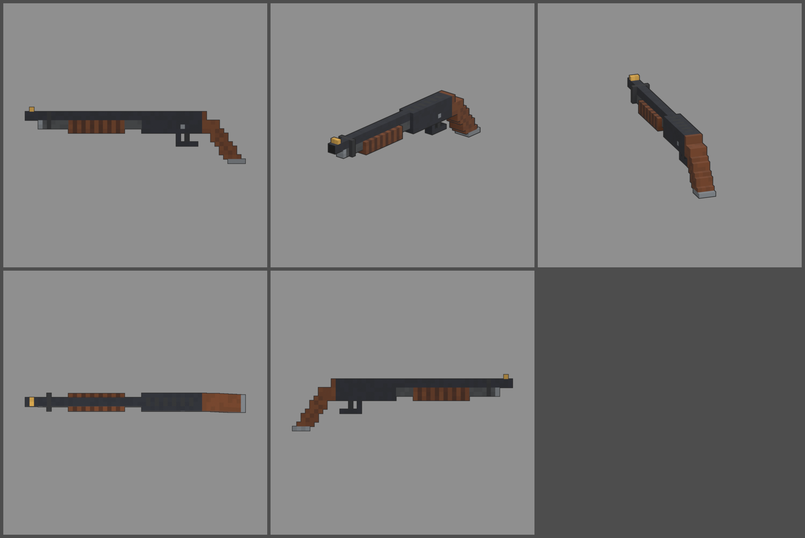

# Fiche d'arme — IT-37 (fusil à pompe court)

Statut : **proposition, à valider**. Refonte des armes du 2026-10-12 : armes
réelles de référence, noms proches des vrais, cubes de 1,25 cm, pièces
visibles. Statistiques du jeu (`WeaponDB`, GAME_CONCEPT § 4.9).

*Ligne du haut : profil gauche, trois-quarts, vue du tireur. Ligne du bas :
dessus, profil droit.*

## Identité

| | |
|---|---|
| Référence réelle | Ithaca 37 « Stakeout », calibre 12, canon de 337 mm, poignée pistolet sans crosse, 4 + 1 coups |
| Nom affiché (FR / EN) | **IT-37** / **IT-37** |
| Identifiant interne | `stakeout` (inchangé) |
| Famille | fusil à pompe |
| Niveau de base | 4 (inchangé) |
| Rôle | fusil à pompe court et maniable : gerbe très large, recul brutal sans crosse, peu de cartouches |

Nom : on ne reprend ni la marque « Ithaca » ni le nom du modèle
« Stakeout ». On garde le numéro du modèle.

## Statistiques

| Statistique | Proposition | Ancien BALAI | Pourquoi |
|---|---|---|---|
| Dégâts par plomb | **70 × 8 plombs** (560 par coup) | 70 × 8 | calibre 12 |
| Multiplicateur de tête | × 1,5 | × 1,5 | famille |
| Cadence | **75** coups/min, pompe | 70 | pompe courte et rapide |
| Chargeur / réserve | **5 / 45** | 6 / 54 | 4 + 1 coups comme le vrai, 9 recharges |
| Rechargement | **2,8 s** (cartouche par cartouche, par le dessous) | 3,0 s | une cartouche de moins |
| Précision à la hanche | dispersion **8,0°** | 6,5° | canon très court : gerbe large |
| Précision en visée | **6,0°** | 4,0° | |
| Recul | montée **6,0°**, latéral ± 1,2° | 5,0° | sans crosse, on encaisse dans les poignets |
| Portée (début de la perte de dégâts) | **7 m** | 9 m | canon court |
| Pénétration | 1 zombie | 1 | |
| Mobilité | 100 % | 100 % | arme légère |
| Mise en joue | **0,16 s**, zoom × 0,9 | 0,2 s | pas de crosse à épauler |

Repère : de près, un coup tue un zombie jusqu'à la manche 5 (550 PV). Par
rapport à l'IZ-43 (niveau 3), il tire 5 coups au lieu de 2, mais il porte
moins loin et sa gerbe est plus large.

## Pièces (emplacements et points d'attache)

| Famille | Exemples pour cette arme | Point d'attache |
|---|---|---|
| Canon | choke serré, frein de bouche, bec de canard (gerbe aplatie) | `att_muzzle` : bouche du canon |
| Viseur | guidon fluorescent, petit point rouge sur le boîtier | `att_optic` : dessus du boîtier |
| Crosse | crosse repliable (précision +, mobilité −), sangle de poignet | `att_stock` : arrière de la poignée |
| Accessoire | lampe ou cartouchière sur la pompe | `att_rail` : pompe |
| Chargeur | rallonge de tube (+ 2 cartouches) | aucun point : le tube est visible sous le canon |
| Culasse | ressort de pompe renforcé (cadence +) | aucun (statistiques seulement) |

## Design

- **47 cubes de long** (590 mm), 1,25 cm par cube.
- **Largeurs paires** : le canon de 2 × 2 cubes (25 mm) est au-dessus du
  tube magasin de 2 × 2. Un collier noir les relie près de la bouche, où
  l'on voit aussi le bouchon d'acier du tube. Le boîtier fait 4 cubes de
  large.
- **Guidon-bille** en laiton au bout du canon. La ligne de mire passe juste
  au-dessus du dessus strié du boîtier.
- **Pompe** en noyer rainuré (anneaux clairs et sombres) autour du tube :
  c'est la pièce mobile `pump`.
- **Boîtier** bronzé bleu-noir. **Éjection par le dessous**, la signature
  de l'Ithaca 37 : aucune fenêtre sur les flancs, la fenêtre sombre est
  sous le boîtier.
- **Pontet** avec la sûreté transversale, détente.
- **Poignée pistolet** en noyer, épaisse (4 cubes), inclinée d'environ 30°,
  quadrillée, avec une calotte d'acier.
- **Budget** : 1 254 triangles.
